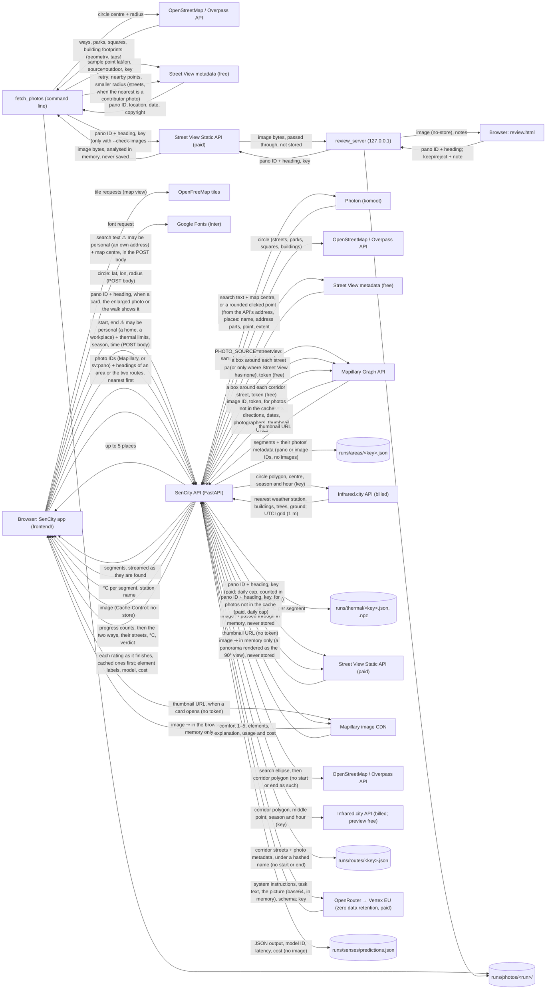

# Architecture

How the tool is built **now**:
- **Backend:** fetching street photo candidates for one circle.
- **Frontend:** the map start screen, address search and the two-click area selection.
- **API:** `POST /api/search` and `POST /api/reverse` (Photon), `POST /api/area` (street segments and their photos, metadata only, then thermal comfort per segment from Infrared.city), `POST /api/routes` (two walking routes between two points), `GET /api/photo/{pano_id}` (a Street View image of a loaded area or route, on demand, never stored, under a daily cap), `POST /api/senses/rate` (the model's predictions for the photos the app shows, general or with your sensory profile), `GET /api/profile/survey` (the onboarding questions and the profile template, from `model/app_v9/`).
- **Photos:** one source, `PHOTO_SOURCE` (2026-11-16): `streetview` in the local prototype (up to 3 per street, one every 10 to 20 m along a street a route walks, Mapillary where Street View has none), `mapillary` in any public version (one per street). The photo shown is the photo rated. A production build refuses `streetview`.
- **Thermal layer:** feels-like °C per street, rated easy, mixed or hard in the app with the standard limits.
- **Routes:** Start and End, the shortest and the easiest way on Thermal, compared stretch by stretch; on Overall the same two ways coloured by the worse of Senses and Thermal, with each route's share of easy, mixed and hard.
- **Senses (general, no profile):** every photo of an area or of the two routes is rated in the background (`POST /api/senses/rate`), from the settings in `model/app_v9/`: a presence call lists the elements clearly visible in the photo and counts the people, Crowds being listed at the export's threshold or more (cached per photo), then the rating call uses the study's task and schema on that list, with the system instruction alone (the study's V0). Places appear on the map as ratings arrive, with recommendations beside them.

- **Your sensory profile (phase 1, this device only):** the Profile tab holds the onboarding (Part A of the survey: the eight-senses intro, A11, A12, A13, A16, from `model/app_v9/part_a.json`), the profile (the radar of the eight senses; every answer, editable; your words), download and import as a JSON file, and Delete my profile. With a profile, Senses ratings are personal (the study's V2); without one they are general (V0), with a "Not personalised yet" box and a shortcut to the onboarding.

Overall shows, per street, the worse of Senses and Thermal (one layer only: "partial", the same colour at half opacity); with a profile it is the default layer. "Before you start" (consent) comes before a new profile and an import. Not built yet: personal thermal limits, "Places that may suit you", group mode, accounts.

## Data flow

⚠ marks data that may be personal: what people type in search can be their own address. It is never logged or stored: the API forwards it to Photon and passes the answer back. Photon sees the API's address, not the user's. The start and end of a route can be a home and a workplace: they are never logged or stored. The services see only polygons around the way, but the search ellipse's foci are the two points and the corridor runs from one to the other, so these do show roughly where someone walks, as does the route cache. No other arrow carries personal data. Review notes are Elena's own judgement of the photos. The selected area stays in the browser (Pinia store) until analysis is built.

## Modules

| Path | What it does |
|---|---|
| `backend/tool/fetch_photos.py` | CLI: OSM → segments → metadata → selection → outputs; optional image check |
| `backend/tool/osm.py` | Overpass query, tag filters, sidewalk test, street and area segments |
| `backend/tool/osm_local.py` | Local copy of OpenStreetMap for Vienna, in tiles (`python -m tool.osm_local`); answers for a circle or a polygon in Overpass's shape, or leaves it to Overpass |
| `backend/tool/segments.py` | Pure: chains between intersections, clip to circle, cut into ~50 m pieces, merge leftovers under 10 m |
| `backend/tool/candidates.py` | Sample points, metadata lookups with the contributor-photo retry, one candidate per (pano, heading) |
| `backend/tool/selection.py` | Pure: the photo choice rule (brief §4, steps 1–3 and 6), official only on streets, contributor fallback in areas, indoor photos rejected |
| `backend/tool/image_check.py` | 70% sharp/unblocked check per tile, in memory |
| `backend/tool/photos/provider.py` | `PhotoProvider` interface and `get_provider(cfg)` |
| `backend/tool/photos/streetview.py` | `StreetViewProvider` (metadata, image, cost) |
| `backend/tool/review.py`, `review_template.html` | Writes review.html with the run's data embedded (no key, no images) |
| `backend/tool/review_server.py` | FastAPI: `/` page, `/image` proxy, `GET/POST /notes` |
| `backend/tool/infrared.py` | Infrared.city run for one circle and window: job count check, nearest station, buildings, trees, ground, UTCI grid (billed) |
| `backend/tool/thermal.py` | Pure: `thermal_state` (the app's band rule, for the routes), grid cell centres, the percentile of the cells along each segment |
| `backend/tool/geo.py`, `config.py` | Local metric projection, circle, bearings; config and `.env` loading |
| `backend/app/main.py` | SenCity API (FastAPI): `POST /api/search`, `/api/reverse`, `/api/area`, `/api/routes`, `GET /api/photo` (Street View images of loaded areas and routes only), CORS for the app's origin, a per-IP rate limit; no request bodies logged |
| `backend/app/search.py` | Photon request and result mapping (name, detail line, point, extent); the name of a clicked point (spaced calls, in-memory cache) |
| `backend/app/steps.py` | The finished steps of a load that did not complete (Overpass answer, photos per segment), read back by the next try for the same key |
| `backend/app/photos.py` | The app's photos from `PHOTO_SOURCE`: `Finder` (Street View by the step-1 rule, up to 3 per street; a walked street every 10 to 20 m facing the walk; the Mapillary photo where Street View has none; or Mapillary only; never a photo nearer another street, `belongs`), the cache-key settings, the known pano and heading pairs, `StreetViewImages` (on demand, in memory, the daily cap in `runs/streetview/usage.json`), `Images` (the picture for the model, by source) |
| `backend/app/area.py` | Segments and their photos for one circle (one lookup per street, in parallel, `app/photos.py`), progress events, the area cache; the thermal step and its cache |
| `backend/tool/routing.py` | Pure: the graph on the street segments (gaps closed with short connectors), snapping a point to a street, Dijkstra, different ways, choosing B |
| `backend/tool/photos/mapillary.py` | Mapillary photos (all of them with `PHOTO_SOURCE=mapillary`, else the fallback): per street (either way along it), per street a route walks (`photo_walking`: a panorama turned to the walk, else a flat photo within `walk_photos.max_turn_deg` of the walking direction at its spot, never the other way; `offset_deg`), per place (any direction), one Graph API search each (the token stays here), then a panorama within 30 m, else the flat photo closest to the direction; the public thumbnail URL and the credit. `Images`: the photo for the model, in memory (a panorama rendered as the 90° view at its heading, `render_pano`) |
| `backend/app/routes.py` | Two routes: search ellipse, corridor that fits the tile limit, its photos (each walked street with its direction and the way's next points, `walk_directions`), the route cache, A and B, the verdict sentence; `orient_photos`: the route streets' photos facing the way each route walks them (only those along the part each route walks, in walking order; turned, or kept within 60°, with `offset_deg`; a street two routes walk takes A's direction) |
| `backend/app/formula.py` | The optional formula paragraph of a personal prediction (`senses.formula_mode`: none, the default; xhat; f; the study's V2 + x̂ and V2 + f): reads `formula_xhat.txt`, `formula_f.txt` and `formula_rules.json` (after the MANIFEST check); s (the mean of your answers for the photo's listed elements) computed in code; the paragraph placed before the profile's closing line. The others' average and the coefficients come from two sources that answer None for now (no participant data in the app), so every prediction falls back to the plain V2 and nothing is said about a formula. The mode used goes in the personal rating's stamp |
| `backend/app/chat.py` | The chat parser: one message → one intent (action + parameters, a strict JSON schema), one model call at temperature 0 on the export's model and pinned endpoint (zero retention, no fallbacks), the fixed prompt `config/chat_prompt.txt` with the 20 element codes; checks the intent (known values only). The message text is all it gets; never stored or logged. `matches` compares an intent with an expected one |
| `backend/app/chat_eval.py` | `python -m app.chat_eval dev|test`: intent accuracy on the development set or the frozen test set (`backend/tests/fixtures/chat_intents_*.json`), paid |
| `backend/app/prepare.py` | How you prepare for new places: reads and checks `config/prepare.json` (Q1 = the thesis's tool-only A15, Q2–Q4 Elena's; English only), served with the survey; `offers_for` gives what the app or a chatbot can offer first from the Q2 answer. The answers stay in the browser and never come in a rating request |
| `config/prepare.json` | The questions of the optional last part of the onboarding (Q3 a 1–5 scale since 2026-11-21), and the mapping of each Q2 option to an offer (place card photo, crowds and quieter alternatives, best time, Senses route comparison, rest places, a take-with-you tip, share the card, short summary) |
| `backend/app/profile.py` | Your sensory profile: reads `part_a.json`, `profile_template.txt` and `profile_rules.json` (after the MANIFEST check); the survey for the onboarding; checks a person's answers against Part A; builds the profile text exactly as the study does (V2), and its version (the first 12 hex digits of its sha256). Nothing stored or logged |
| `backend/app/senses.py` | Senses mode (personal ratings relayed, never cached; the cache holds general ratings and presence lists only): reads `model/app_v9/` on every request, checks every file against its sha256 in the MANIFEST, then its contents; splits a list of photos (Mapillary IDs, or `sv:<pano ID>`) into cached and new (the cap), rates the new ones 4 at a time: the picture from its source in memory (Street View under the daily cap), the presence call (unless cached; Crowds from its people count and `presence_schema.json` `crowds`), the task and schema for the listed elements, the OpenRouter request, each reply validated (one retry); both caches, and the stale marks on Street View and V0 ratings and on general ratings from before the current prompt version (re-rated when asked for) |
| `model/archive/app_v0/` | The V0 export from the thesis repo (codebook 2026-11-08), kept for the record. Not read |
| `model/app_v9/` | The survey v9 export (codebook 2026-11-12, file hashes in its MANIFEST): 20 elements in EN and IT, Part A, profile template and rules, task template and rules, schema template, presence prompt and schema (the automatic element list per photo; Crowds as a people count with its threshold), the two formula texts and their rules (`formula_mode`), model settings. The only source of these; replaced as a folder. The profile files are hash-checked but not read yet |
| `backend/app/__main__.py` | `python -m app`: runs the API with access logs off |
| `backend/tests/` | Unit tests for segment splitting, selection and search (no API calls) |

**Frontend** (`frontend/`, Vue 3 + Vite, plain JavaScript):

| Path | What it does |
|---|---|
| `src/main.js`, `src/App.vue`, `src/router.js` | App entry; `/area` and `/routes` are one view around one map (`/` and any other path redirect to `/area`) |
| `src/views/MapView.vue` | Map view, for Area and Routes: places every floating panel from the viewport; phone layout below 768 px |
| `src/components/MapCanvas.vue` | MapLibre map, theme style swap, the two-click selection (pointer, touch, keyboard), crosshair, edge handle, radius chip, pan to keep the circle visible; in Routes: clicks set Start and End, pins, hover and click on a stretch, fit the way in the free space |
| `src/map/routes.js` | Route layers: each street in its state colour, A continuous, B dashed over runs of one state, glow, selected edge, the rest dimmed on hover |
| `src/stores/routes.js` | Pinia: Start, End, the preview before Analyse, loading the ways (progress, cancel, errors), the routes and their stretches, shown or hidden, selected stretch, linked hover, season and time |
| `src/lib/routes.js` | Pure: a route's parts to stretches (one per street), runs of one state, a stretch as one place for the card, distances |
| `src/components/RoutePanel.vue`, `RouteLayerButtons.vue` | Routes left panel (desktop, tablet): the walk inputs (`RouteInputs`), Layer, season and time, then one line on the layer (no legend). On a phone the route card carries the same inputs and Layer, as the area sheet does |
| `src/components/RouteCard.vue`, `RouteBar.vue` | "Which way feels better?" (no card before Analyse on desktop and tablet; the hint says what to do): the progress, the comparison; on a phone also the inputs with Analyse; one state bar per route, each street a button (a bottom sheet on a phone) |
| `src/components/StretchCard.vue` | A selected stretch: the place card with the route bar, coverage, previous / next, arrow keys |
| `src/stores/walk.js` | Pinia: the walk along a route, a slideshow of photos, and the enlarged photo (`start` with `index`, `autoplay`, `backTo`; `openPlace` for a place of an area, 'place' mode): a copy of the walked route, its layer and window fixed at the start, the current stretch, its street's photo and rating, exactly as the Routes view and the stretch card have them (`ratedPhotoOf`; nothing is looked up or rated again, so nothing changes colour; a photo whose image does not load counts as none), "Where you are" (`point`: the photo's spot, else the stretch's middle), Play / Pause (one stretch every `config.walk.stretchMs`, its photos sharing it, each at least `photoMinMs`); a stretch with several photos (Street View) is stepped photo by photo (`sub`, `photos` in the order walked past) |
| `src/lib/walk.js` | Pure: where you are on the walk ("0.35 of 1.6 km, 5 of 21 min"), the bearing along a stretch, the chip ("easiest for your senses", "shortest"), the fixed-settings line, a stretch's photos and rating as the Routes view has them (`ratedPhotoOf`), its photos in the order walked past (`photosInOrder`), the stretch's state and reason from the ratings already loaded |
| `src/lib/photos.js` | Each photo's source (`streetview`: the image through `/api/photo`, "© Google", no link; `mapillary`: the thumbnail, "{username} · {year} · CC BY-SA 4.0", the image page), whether photos are shown at all (`config.photos.shown`), the map credit (the build's `PHOTO_SOURCE`), the Street View images shown (for the dev cost line); a panorama's crop at the walk's bearing (`panoShift`) |
| `src/stores/cardPhotos.js` | The cards' photos come with their streets: a Mapillary image preloaded when the pointer rests on a street (never a paid Street View image), and the open card's photo direction for the map's arc |
| `src/components/WalkView.vue`, `WalkChip.vue`, `WalkPhoto.vue`, `WalkDetails.vue`, `WalkMiniMap.vue`, `WalkControls.vue` | The walk (board Routes 5, photos and play), its own panel over the map (under the top bar; on a phone one scrolling column above the tab bar, "Where you are" as a strip above the photo), no 3D street: Exit, the chip centred over the photo ("Walking route B · easiest for your senses", "… · shortest"), "Stretch n of N"; the square photo the stretch is rated from (or a square saying "No photo for this stretch, so no rating.") with previous / next stretch beside it at its middle; under it, as wide as the photo, the route bar with a mark where you are (a click jumps there), then Play, "0.35 of 1.6 km · 16 min left" and the key (`ComfortKey inline`, the window first on Thermal); on the right "Where you are" (a flat map, north up, that follows the photo's spot, with its direction) and the stretch card ("Mixed for your senses", "The model points to: …; ….", two columns of sense rows, Rate this place, not built). Keys: ← → photos or stretches, space plays or pauses, Esc goes back. A stretch with several photos says "Stretch 2 of 9, photo 3 of 4" and its arrows "Next photo" until the last. It is also the enlarged photo: from a stretch card, paused at that stretch on the card's photo, Back to the stretch; from a place of an area, 'place' mode, with no chip, Play or bar, only the key under the photo (with several photos, arrows, ← → and "Photo 2 of 3"), Back to place |
| `src/components/SenseItem.vue` | One thing that might bother or feel good: its main sense's icon and label, a row with no border (walk, place card, stretch card) |
| `src/components/MarkerArc.vue` | The photo's direction on a marker: a 90° arc at a radius, with a pulsing copy (the selected point, the suggestion pins, the walk's "Where you are") |
| `src/components/PlaceSearch.vue` | One search field with suggestions, used by the top bar, Centre, Start and End; reports Enter on a value already chosen |
| `src/map/base.js` | Dark mode only: recolours the Positron base map from `--map-base-*` in `style.css`, after every style load |
| `src/map/layers.js` | Our map layers: teal tint, lit circle, dimmed outside (world minus circle), dashed circle and radius line; colours read from `style.css` |
| `src/lib/geo.js` | Radius maths: haversine, limits (snap to 50 m, cap at 500 m, round to 10 m), 64-point circle, mask, photo estimate, coordinate label |
| `src/stores/area.js` | Pinia: selection step (`centre` → `radius` → `set` → `analysed`), centre, radius, the analysed area `{lat, lon, radius}`; loading the area (progress, cancel, errors), its segments, the Places filter (`placeFilter`, `visibleSegments`); the markers (`suggestions` on the Thermal layer, `chatMarkers` hook with `showChatResults` / `clearChatResults`, `markersCollapsed` (hidden after selecting an unmarked place), `seenIds`); the selected segment (and `cameFrom`, the street a nearby link was followed from; `goNearby`, `goBack`); thermal comfort (state, window, station) and the layer on the map |
| `src/stores/profile.js` | Pinia: your sensory profile on this device: the survey (loaded once), the saved profile (`sencity-profile`), the onboarding in progress (`sencity-profile-draft`, every answer including how you prepare for new places, kept when you go back or leave halfway; `STEPS` = the profile part then Q1–Q4), one save after the last question (builds the text and its version), edit, import, Delete my profile; the made-up test profile in dev mode only |
| `src/lib/myRatings.js` | Your own photo ratings, in this browser only (`sencity-my-ratings`): each with an id, your rating `{ B1, B2, B2_other }` and the prediction shown before it (or null), appended; B2 ticks and B2_other ("Something else?", never sent to a model) updated on the same entry; how close SenCity is to you (gap, within 1 point) |
| `src/components/HowClose.vue` | Profile: how close SenCity is to you: three numbers; for personalised predictions the gap as predicted and as adjusted, and the opt-in "Adjust to my own ratings (experimental)" (disabled under `MIN_RATINGS` personal ratings) |
| `src/lib/adjust.js` | Pure: the on-device correction: the mean gap (own − prediction) over ratings of personalised predictions (null under `MIN_RATINGS`), the shift (whole points, the same way up and down, clipped to 1–5), applied to personal results only with the model's value kept in `adjusted.from`, the note, and how close as predicted and adjusted (leave one out) |
| `src/lib/chat/intent.js` | The chat's intents: cleaning, "this" = the open place (English or Italian), the ready-made prompts, the pills (the level names the layer it follows: "easy · Overall") and removing one |
| `src/lib/chat/execute.js` | Pure: each action on the browser's data: filter the area's places (level on a layer, elements in the photos, a circle), explain a place, summarise the profile, the facts of a place or the whole area (photo ratings from–to, thermal levels and why, elements in the photos) and the person's own answers about preparing |
| `src/lib/chat/templates.js` | The replies, in fixed English words (the model never writes them); the Italian note; the examples of "What can I ask?" |
| `src/stores/chat.js` | Pinia: sends a message (`POST /api/chat`, text only), carries the intent out through the area, routes, senses and profile stores (search through `searchPlaces`), marks results with `area.showChatResults`, replies from the templates; a result clicked opens its place card (the chat closes, "Back to the chat" on the card); a request near a new place waits for that area |
| `src/components/ChatPanel.vue` | "Ask about places" (board 2): messages, result cards, removable pills, ready-made prompts, "What can I ask?", the input with a rotating example; full screen on a phone. Opened by Ask; "Why is this hard?" on a hard place card |
| `src/stores/adjust.js` | Pinia: whether the feature is shown at all (`ENABLE_ADJUST` in `src/config.js`, false for now: no setting, no adjusted figures, no notes, no gap), the setting (`sencity-adjust`, off by default), your ratings read again after a new rating, an import or a delete, and the gap in use (null when off or not enough) |
| `src/components/RateThisPlace.vue` | "Rate this place" on the map card, the enlarged photo and the walk: keeps your rating with the prediction on screen; "You: 2 · SenCity: 3"; then "What made the difference? (optional)": the listed elements as + / − chips and a collapsed "Something else?" text; rating pauses the walk |
| `src/lib/personalRatings.js` | Your personal ratings in this browser only (`sencity-ratings`): found by photo and profile version, each with its stamp (element list, model, export); only the current profile's are kept; cleared by Delete my profile |
| `src/lib/profile.js` | Pure: required answers, cleaning, the profile text as the study builds it (`profile_template.txt` and `profile_rules.json`, from the survey), its version (sha256, as on the server), what a rating request carries (answers and language, never the text), the export file and reading it back, the strongest elements, the radar's senses in onboarding order and their two values (what bothers you, what feels good, 1–5) |
| `src/dev/test-profiles.json` | Four made-up profiles with the texts the study's own code makes for them: the tests (frontend and backend) and the dev-only test profile. No participant data |
| `src/components/ProfilePage.vue` | The Profile view over the map: onboarding, profile or empty state; download, import, delete |
| `src/components/ConsentScreen.vue` | Board 3, "Before you start": four points, an unticked box, Not now and Agree and start (only once ticked) |
| `src/components/ProfileOnboarding.vue` | Boards 4, P4: the profile part, one question group per screen, progress, Back and Next (never disabled: with an answer missing it says so and goes there), Skip for now (answers kept) or, when editing, Cancel; after Weather it goes on to PrepareOnboarding |
| `src/components/ScoreChoice.vue` | One 1–5 answer: five radio buttons in a fieldset, with the element's sense icon |
| `src/components/ProfileSummary.vue` | Board 5: the radar, the answers (folded) with Edit; in the right card overall sensory comfort (A11) as a gradient bar, your words, Edit answers, Go to map, Download my data, Import a file, Delete my profile |
| `src/components/ProfileRadar.vue` | Board 5: the radar of the eight senses (onboarding order, icons, rings 1–5): what bothers you (pink) and what feels good (cyan), a gap where a sense has no answers; tapping a sense lists its elements in a card next to it; legend |
| `src/lib/overall.js` | Overall: the worse of a street's Senses and Thermal levels (partial with one, none with neither), the deciding layer in plain words, a route's shares |
| `src/components/OverallSummary.vue` | The place card on Overall: level, reason, the Senses and Thermal rows, what might bother or feel good |
| `src/components/PrepareOnboarding.vue` | How you prepare for new places, the last part of the onboarding (also opened at Q1 from "Your profile"): one question per screen, all optional, in the draft; the button after Q4 is the one save (Save your profile / Save changes) |
| `src/lib/prepare.js` | Its answers: cleaning, ticking (an exclusive option alone), answered only in the question's own type (an old Q3 word is unanswered), the words on "Your profile", the offers from Q2 |
| `src/lib/weather.js` | The Weather step: its words (EN, IT), cleaning the answers, wind sensitivity |
| `src/components/ThermalComfortBar.vue` | "Temperature that feels comfortable to you": −20 to 40 °C, blended comfort colours, the person's four limits and the standard ones faint, two draggable handles (keyboard 0.5 °C), Reset, the summary line |
| `src/components/ProfileEmpty.vue` | Board 5b: no profile yet, Create your profile, import, the dev-only test profile |
| `src/components/DeleteProfileDialog.vue` | Board 5c: alert dialog, focus on Cancel, Download a copy first, Delete everything |
| `src/stores/theme.js` | Pinia: Appearance System / Light / Dark, follows `prefers-color-scheme` live, override in `localStorage` |
| `src/components/TopSearch.vue` | Logo + search (`PlaceSearch`); picking moves the map |
| `src/lib/api.js` | Calls to the SenCity API: `searchPlaces`, `pointName`, `loadArea` and `loadRoutes` (read the streamed events), `photoUrl`; error type, place-type labels |
| `src/components/ViewTabs.vue`, `TopActions.vue` | Area / Routes / Profile (bottom tab bar on a phone); About, Print (opens the report), light/dark (one click), Ask, account |
| `src/components/AccountMenu.vue`, `AppearanceSwitch.vue` | Account menu (board P5) with the System / Light / Dark switch and About |
| `src/components/AboutDialog.vue` | About and how to use (board 7): seven sections, the map legend's swatches, Show tips again; a modal on desktop, full screen on a phone; Esc closes, focus goes back |
| `src/components/ReportView.vue`, `src/stores/report.js` | The printable report (boards 8, 8b; brief §7), from the print icon, the account menu and Print area report: a preview of A4 pages over the app with "Print / Save as PDF" (the browser's print) and Close; Esc closes, focus goes back. Always light, in the print colours (`--report-*`), whatever the theme. Print CSS (`@page` A4 portrait, no margin; each page keeps its own 13 mm) prints only the pages, one per sheet. Footer on every page: "SenCity gives a prediction, not advice. Check the place yourself." and "Page n of N" |
| `src/components/ReportProfile.vue`, `ReportArea.vue`, `ReportRoute.vue`, `ReportPlace.vue` | The report's sections: the radar (SVG, `lib/profile.js` `radarShape` shared with the profile), own words, overall comfort, strongest, comfortable temperature; the area's map, centre, radius, season and time, four counts, Why hard (Overall), Places here; the two routes' map, rows, legend and verdict; the place with the photo already loaded on its card (never fetched again: else "Photo not available"), its credit, overall level and parts, V0 or V2 |
| `src/lib/report.js` | The report, pure: which sections appear (`reportSections`), how they share the pages (`reportPages`, by measured heights), "In short", the area's counts, Why hard, Places here (also the area card's), the routes' verdict and coverage (also the route card's), route rows |
| `src/map/print.js` | The report's maps: a hidden MapLibre map the size of the printed map, light base map without place names, the area's streets or the two routes in print colours; returned as a data URL kept in memory while the report is open, never saved or sent |
| `src/components/HowLink.vue` | "How this works": opens About at a section (rating card, comfort key, profile, comfort bar) |
| `src/components/FirstHint.vue`, `src/lib/help.js`, `src/stores/help.js` | First-time tips: the Area and Routes settings one part at a time ("Tip 2 of 4", Next, Skip tips), then one each for the results, place card, walk and profile; which were seen in `sencity-tips-seen`; About's open state and section |
| `src/components/LayerPanel.vue`, `MapControls.vue`, `MapAttribution.vue` | Left panel, settings only: the area inputs (`AreaInputs`), Layer, Season and time (not for Senses), Places buttons (All / Streets / Parks / Squares filter the map and the suggestions once the area is loaded), then one line on what the layer's colours mean (`lib/legend.js`); never the legend; zoom and re-centre; credits |
| `src/components/PhoneSheet.vue` | The one bottom sheet on a phone: tabs Settings (`LayerPanel` or `RoutePanel`) and Results (the cards), minimised or open at one fixed height, dragging, the automatic switching, and the key (`ComfortKey`) and credits riding above it; the key is not shown with a place or stretch open, and not again inside the sheet |
| `src/components/ChoiceButtons.vue` | The one kind of choice control: separate bordered buttons as a radiogroup, thick (Layer) or thin (Places, Radius, Season) |
| `src/components/ComfortKey.vue`, `src/lib/legend.js` | The one shared key: "Sensory comfort", or "<Layer> · <season>, <time>", then Easy / Mixed / Hard / No photo (No value on Thermal) on one line. Straight after the bar(s) of the area card and the route card (Senses, Overall), at the top of the walk's right card, and floating above the phone sheet; never in the left panel or on a detail card. `lib/legend.js`: its title and rows, the left panel's layer line, and the area's bar by street length (`lengthShares`) |
| `src/components/LayerButtons.vue`, `SeasonTime.vue` | Area layer buttons (left panel, or the area card when the left panel gives way), only Thermal active until the ratings are built, and Season and time: four season buttons and a 9–21 h slider, shown for Thermal and Overall (and before analysis), used by the left panel, the Routes panel and, on a phone or below 1200 px, the area and route cards; active before analysis (Analyse uses the choice) and once thermal is ready, where a new season or time asks for thermal again |
| `src/components/InputSection.vue`, `AreaInputs.vue`, `RouteInputs.vue`, `AnalyseAction.vue` | The area and walk inputs at the top of the left panel (or the sheet): closed, one row with an icon, the values ("Graben · 200 m", "Clicked point → …"), a chevron and Change (clears everything); open, Centre and Radius (100 / 200 / 500 m, plus the mouse's value) or Start and End (address search) with a swap button; under them Analyse and its estimate line, disabled until everything is set (Enter in Centre or End starts it). A city only pans the map; a focused field takes the next map click |
| `src/components/StepHint.vue`, `AreaCard.vue` | Step hints (Flow 1, 1b, 1c; Routes 1), with "type an address" that opens the inputs and focuses the first empty field, and the "This area" card (Flow 4 once loaded: the street stretches of the layer as one stacked bar with counts and %, "Likely easiest for you" (numbered as the map pins, seen ticks, or "Nothing easy here"), places by type, Print area report (opens the report); or why thermal is missing, with Try again; a bottom sheet on a phone) |
| `src/components/MarkerPin.vue` | The numbered marker badge (map pin and list row) |
| `src/components/ThermalLegend.vue` | The thermal legend on Thermal, in place of the key: straight after the bar(s) of the area card and the route card, at the top of the loading card once thermal is ready; title "Thermal comfort °C · <season>, <time>" with an info icon (tooltip on hover, focus or tap: what the feels-like temperature is, the easy range, the source), Easy with its range, Mixed and Hard only for the side the values reach |
| `src/components/LoadingCard.vue` | "Loading this area" (Flow 2, 3): streets, then street photos with progress; thermal, or on Senses and Overall the rating with its progress and running cost; once thermal is ready, the legend of the layer on the map at the top (Overall: its key; Thermal: the °C bands); Cancel (while rating, it only stops the rating) |
| `src/components/PlaceCard.vue` | The selected street (2f, 2g; phone P2): photo (only when `lib/photos.js` shows photos; else "Photo not shown") with arrows, enlarge badge, credit, thumbnails, date and direction; "Not rated yet"; on the Thermal layer the photo and name, then thermal comfort (2e): feels-like °C, state and why, a temperature bar on the legend's side rule, a cooler (or warmer) street nearby as a link that selects it and zooms there, and "Back to <street>" on the card it opens; no-photo state with "Go to the nearest street with photos" |
| `src/map/segments.js` | Segment layers (halo, core, dim, selected edge, invisible hit line) with hover and selection as feature-states; the Thermal layer lights every street with a value in its state colour |
| `src/map/markers.js` | Marked places (suggestions, later chat results): each stretch or outline thicker in its level colour with a light outline, above the street colours and below the hit layers |
| `src/lib/thermal.js` | `thermalLimits()` (the limits in use: personal from the profile's Weather step and its bar when set, else the standard ones from config; reactive, so the map, cards and routes follow); `personalLimits`, `clampStart`, `comfortSummary`; feels-like °C to the state (easy, mixed, hard; no score); the card's temperature bar (`thermalBar`, `barPosition`, `barLabel`); `comfortKey` / `compareComfort` (degrees outside the easy range, then distance from its middle, shared by the nearby street and the suggestions); the card line ("Hard: above 32 °C"), legend rows for the side the values reach and the note under it; walking minutes; adding thermal to the segments |
| `src/lib/suggest.js` | "Likely easiest for you": `pickSuggestions` (greedy, at least `config.suggest.minApartM` apart, a new type first within `margin`, ties to the nearer centre; any layer passes its own keep and value) and `thermalSuggestions` (easy places in the Places filter, closest to the middle of the easy range first, via `comfortKey`) |
| `src/lib/nearby.js` | "Easier street nearby": `easierNearby` (within `config.nearby.maxM`, at least one level better, the best rank first, then the shortest walk; any layer passes its own level and rank) and `easierThermalNearby` (Thermal, ranked by `comfortKey`) |
| `src/lib/place.js` | The place filter (All, Streets, Parks, Squares) and which one a segment belongs to; words for the cards: place type, size, "Looking north-east, July 2024", distance from the middle, credit, nearest street with photos |
| `src/stores/senses.js` | Pinia: starts the rating when an area or the two routes are ready, with your profile when there is one (a new or deleted profile rates what is open again); the ratings by photo (the model's own; `ratingOf` shows personal ones shifted when "Adjust to my own ratings" is on, so the map, cards, routes, walk and report follow), the run (progress, cost, the question above the cap, errors, Retry), the state of each street for the map |
| `src/components/SensesPanel.vue` | In the area (Senses and Overall) and route cards: progress and running cost, the question above the cap, the label and status line, and once the rating has ended most comfortable nearby |
| `src/lib/senses.js` | Pure: one place from its photos (median, shared elements), the recommendations (Senses, and Overall: easy or mixed on both layers), a route's hard share and verdict on Senses, a 1–5 rating to its state (easy, mixed, hard), "4 · fairly comfortable" (the survey's words for 1 and 5), an element's label in the app's language, the status line |
| `src/components/SensesFoot.vue` | The end of a Senses card, area or routes: after a profile edit "from your earlier profile" with Rate again with your profile; "Personal prediction: from your sensory profile" or "General prediction: not personalised yet" with the "Not personalised yet" box and Create your profile (board 2c), and the status line |
| `src/components/SensesPrediction.vue`, `SenseIcon.vue` | A place's rating on the place and stretch card (board 2c), from the ratings already here: waiting, "Could not rate" with Retry, the rating bar, might bother and feel good, the model's explanation; one sense icon |
| `src/components/AppLogo.vue`, `AppIcon.vue` | Logo (paths from `src/assets/logo/sencity.svg`, drawn in `var(--logo)`) and line icons |
| `src/styles/style.css` | Every colour, font and size as a CSS variable, dark and light |
| `src/config.js` | Radius limits, start view, map style URLs, photo estimate, default thermal window |
| `src/lib/geo.test.js`, `thermal.test.js`, `routes.test.js` | Vitest: radius maths; thermal score, states and labels; stretches |
| `e2e/` | Playwright: step-by-step screenshots, fit-every-screen check, keyboard walk-through, Routes, the walk (`walk.spec.js`) |

## Data formats

**Street segment, photo script** (`segments.geojson`, one feature each, WGS84):
`segment_id` str · `kind` "street" | "area" · `name` str · `highway` str (OSM type, or park/square) · `osm_ids` [str] · `length_m` float (streets) or `area_m2` float (areas) · `n_candidates` int · `pano_ids` [str] · `contributor_photos` int · `photos` [{`pano_id`, `heading`, `date`, `lat`, `lon`, `photo_type`}].

**Photo candidate** (`photos.csv`, one row per pano × heading × segment):
`segment_id`, `pano_id`, `lat`, `lon`, `date` (YYYY-MM), `heading` (°), `status` (kept/rejected), `reason`, `rank`, `dist_to_segment_m`, `dist_to_midpoint_m`, `photo_type` (official/contributor), `sharp_share` (0–1, only after the image check).

**Review note** (`review_notes.csv`): `segment_id`, `pano_id`, `heading`, `pipeline_status`, `pipeline_reason`, `verdict` (keep/reject/empty), `note`, `updated_at`.

**Run cache**: `osm.json` (raw Overpass answer), `buildings.json` (building footprints for the indoor test) and `metadata.json` (pano ID, location, date and copyright per segment, plus the total number of metadata calls and the retry counts). These let a re-run in the same folder make no new calls.

**Search** (`POST /api/search`): request `{ q: string (3–100 characters), lat: number | null, lon: number | null }` (the map centre ranks nearby places first). Response `{ results: [{ name: string, detail: string, lat: number, lon: number, kind: string, bbox?: [[west, south], [east, north]] }] }`, up to 5. Errors: 422 (too long), 429 (rate limit), 502 (Photon unavailable).

**Reverse** (`POST /api/reverse`): request `{ lat: number, lon: number }`. Response `{ name: string | null }`. Errors: 429 (rate limit), 502 (Photon unavailable).

**Area** (`POST /api/area`, request `{ lat: number, lon: number, radius: number (50–500), season?: "spring" | "summer" | "autumn" | "winter", time?: "HH:00" }`, default summer 15:00): newline-separated JSON events. `{type: "segments", features, total}` gives all segments with `photos: null` (still looking). Then one `{type: "segment", feature, done, total}` per segment with its photos. Then `{type: "done", area: FeatureCollection, cached?: true}`, or `{type: "error", message}` (the stream ends). A cached area starts with "done". After "done": `{type: "stage", stage: "thermal"}`, then `{type: "thermal", season, time, station: {name, distance_km}, values: {segment id: °C | null}}` or `{type: "thermal_error", message}`.

**Street segment, app** (a feature of that FeatureCollection; `id` is also the feature id): geometry LineString (street) or Polygon (park, square, pedestrian area), WGS84. Properties: `id` str · `name` str (OSM name, or the way type if unnamed) · `named` bool · `place_type` "street" | "pedestrian" | "park" | "square" · `way_type` str (OSM highway or area tag) · `length_m` float (streets) or `area_m2` float (areas) · `photos` null | [photo] (each shown and rated). A Street View photo: { `id` "sv:<pano ID>", `source` "streetview", `pano_id` str, `lat`, `lon` float, `heading` float (° the view looks), `date` "YYYY-MM", `year` int, `contributor` bool, `copyright`? str (a contributor's) }; up to 3 per street or place, or one every 10 to 20 m along a street a route walks, in the order walked past. A Mapillary photo: { `id` str (Mapillary image), `source` "mapillary" (missing in areas cached before 2026-11-16), `lat`, `lon`, `heading`, `pano` bool, `pano_heading` float | null (° of a panorama's middle), `turn` float, `year` int, `date` "YYYY-MM", `creator` str, `thumb_url` str, `link` str }; one per street (with `streetview`, only where Street View has none).

**Area cache** (`runs/areas/<key>.json`, not committed): `{ lat, lon, radius, created, area: FeatureCollection }`. The key is a hash of the circle and the pipeline settings. Neutral data only: no images, nothing about the person.

**Finished steps of an unfinished load** (`runs/areas/<key>.osm.json` and `<key>.photos.json`; for a route `runs/routes/<key>.ways.json`, `.photos.json`; not committed; `backend/app/steps.py`): when the photo lookups fail or the app cancels, the Overpass answer and the photos chosen so far per segment id (pano or Mapillary image ID, location, date, heading) are kept, so "Try again" makes only the missing calls and is not counted as a new area or route. Removed once the load completes. No images, and no start or end of a route.

**Thermal cache** (`runs/thermal/<key>.json` and `.npz`, not committed): the values per segment and the station, and the UTCI grid (`grid` float32, row 0 south, NaN = no value; `bounds` min lon, min lat, max lon, max lat). The key is a hash of the area key, season, time and thermal settings. Neutral data only.

**Thermal on a segment, app** (added in the browser, `lib/thermal.js`): `utci` float (°C) · `thermal_state` "easy" | "mixed" | "hard" (no score).

**Routes** (`POST /api/routes`): request `{ start: {lat, lon}, end: {lat, lon}, limits: {heat: [3 °C], cold: [4 °C]}, season?, time?, layer?: "senses" | "thermal" | "overall" }` (`senses`: no thermal stage; season, time and station are null, and the "routes" event has empty `routes` and a `candidates` list of ways, in the shape of a route, from which the app picks A and B once their streets are rated). Refused with 422 when the points are under 50 m or over 1.5 km apart, 429 for too many new routes. Newline-separated JSON events: `{type: "stage", stage: "streets" | "thermal" | "routes"}`, `{type: "segments", total}`, `{type: "segment", done, total}` (counts only: nothing is drawn yet), then `{type: "routes", season, time, station, routes, verdict, segments: FeatureCollection (the streets of both ways, as in Area), values: {segment id: °C | null}}`. Or `{type: "error", message}` or `{type: "thermal_error", message}`; the stream ends.

**A route**: `id` "A" | "B" · `kind` "shortest" | "easiest" | "second" · `length_m` · `minutes` · `hard_share`, `mixed_share`, `thermal_share`, `photo_share` (0–1, of the length) · `parts` [{ `segment_id` str | null (a connector), `length_m`, `coordinates` [[lon, lat]] }] in walking order.

**A stretch, app** (`lib/routes.js`): `key` "A-2" · `routeId` · `index` · `state` "easy" | "mixed" | "hard" | "none" · `segmentId` · `length_m` · `coordinates`. One street segment of the route; a connector joins the stretch before it.

**Route cache** (`runs/routes/<key>.json`, not committed): `{ created, lat, lon (the middle), zone (corridor polygon), area: FeatureCollection }`. The key (`corridor_key`) is a hash of the two points in their order and the settings: a street the routes walk has photos facing the way it is walked, so the way back has its own photos; the `walk_photos` settings are in it too (not in `route_key`). Thermal comfort uses `route_key`, the two points either way round, so it is never paid for twice. No start or end, and nothing about the person. Thermal comfort for it is in `runs/thermal/`, as for an area.

**Local OpenStreetMap copy** (`data/osm/vienna/<column>_<row>.json`, not committed): `{ elements: [...] }`, the raw Overpass answer (`out geom`) for one tile: walkable ways, parks, squares, buildings. OpenStreetMap data only.

**Your sensory profile** (frontend, `stores/profile.js`, `localStorage` of this browser only): `sencity-profile` = `{ language: "en" | "it", answers: { A11, A12: {code: 1–5}, A13: {code: 1–5}, A16 }, text, version, saved, weather: { hot, cold, wind }, thermal: { heat?, cold? } | null, prepare: { Q1: 1–5 | null, Q2: { ticked, other }, Q3: 1–5 | null, Q4: { ticked, other } } | null }` (`weather`, `thermal` and `prepare` set the personal Thermal limits and never enter the text or a model request) (text and version as the server builds them); `sencity-profile-draft` = `{ answers, weather, prepare, step, editing }` while the onboarding is open (nothing reaches `sencity-profile` before the save after Q4); `sencity-ratings` = `{ "<photo id>|<heading>|<profile version>": { stamp: { listed, model, commit }, result, saved } }`, the personal ratings (at most 3000, the oldest go first). `sencity-consent` = `{ agreed }` (the date of "Agree and start"). `sencity-my-ratings` = `[{ id, photo: { id, heading, source }, rating: { B1, B2, B2_other }, prediction: { level, B1, version, profileHash, elements, prompt, model, commit, shown? } | null, at, from }]` (`B1` and `level` are always the model's; `shown` is the adjusted value on screen, only when the correction moved it). `sencity-adjust` = `{ on: true }` while "Adjust to my own ratings" is on (absent = off; not in the export file). `sencity-tips-seen` = `["map", …]`, the first-time tips dismissed. Delete my profile removes all seven; the export file has them as `myRatings`. The export file: `{ kind: "SenCity sensory profile", format: 1, saved, language, answers, profile, version, weather, thermal }`; on import only the answers and language are used and the text is built again.

**Selected area** (frontend, `stores/area.js`, in the browser only): `{ lat: number, lon: number, radius: number }` (metres, 50–500, a multiple of 10).

**Senses rating** (`POST /api/senses/rate`): request `{ photos: [{ id, heading, cached? }], profile? }` (Mapillary image IDs, digits only, or `sv:<pano ID>`), nearest first; `profile`: your answers, `{ language: "en" | "it", A11: 1–5, A12: {code: 1–5}, A13: {code: 1–5}, A16: text }` (every grid row answered; A16 may be empty, at most 2000 characters). With it the server builds the profile text for this call only and the ratings are personal (the study's V2): relayed, never kept or logged on the server; `cached` = `{ listed, model, commit, prompt }` is the stamp of the browser's own rating of that photo (nothing personal), answered with `status: "keep"` (no call) while the photo's presence list, the model and the export are the same. Without a profile they are general (V0), cached on the server under `general`; personal entries from before are removed (`drop_personal`). Newline-separated JSON events: `{type: "start", model, cached, to_rate, remaining, personal}`; one `{type: "photo", id, heading, status: "ok" | "failed" | "keep", cached, result | error, cost_usd?, image_usd?, stamp?}` per photo (`image_usd`: a new Street View picture at list price, for the dev cost line) (`stamp` on a new personal result, for the browser to keep); then `{type: "done", seconds, failed, remaining, estimate_usd}`, or `{type: "error", message}` when going on is pointless. A result: `{ comfort: 1–5, anchors: [words of 1, words of 5], bothers: [element], feels_good: [element], reason, model, latency_ms, cost_usd | null, cached, personal }`; `listed`: the codes the presence call found (empty: B2 had no items and B2_none was true); `bothers` holds the elements answered unpleasant or both, `feels_good` those answered pleasant or both, in `elements.json` order; an element: `{ code, n, en, it, icon_key, also }` (`icon_key` is the main sense and picks the icon; `also` is kept for later). `estimate_usd` counts two calls per photo left out. Street View's daily cap reached during a run: `{type: "error"}` with its message. Errors before the stream: 422 (answers that do not fit Part A; the message names the question only), 429 (rate limit), 503 (`model/app_v9/` unusable, or no key).

**Chat** (`POST /api/chat`): request `{ message }` (1–300 characters; any other field is refused) → `{ intent: { action, language, level, with, without, near, radius_m, start, end, calmer, layer, season, time, topic } }`. 20 messages per IP per hour. The browser carries the intent out and writes the reply.

**Survey** (`GET /api/profile/survey`): `part_a.json` as exported (`intro`, `questions` A11, A12, A13, A16 with titles, labels, help, scales; each grid row also has `icon_key`), plus `profile: { template, constants: {"{A11_LOW}", "{A11_HIGH}", "{SCALE_1}", "{SCALE_5}"}, scale_words_en, languages: {en: "English", it: "Italian"} }`, so the browser builds the same text as the server; and `prepare`: `config/prepare.json` as it is (the optional step about new places: Q1–Q4, English, the Q2 offers). Nothing personal. 503 when `model/app_v9/` or `config/prepare.json` is unusable.

**A place, Senses, app** (`lib/senses.js`, in the browser only): `status` "pending" | "rated" | "failed" · `comfort` 1–5 (median of its photos) · `level` easy | mixed | hard · `bothers`, `feelsGood` (elements shared by the photos) · `rep` (the photo the card opens on) · `nPhotos`, `nRated`, `nFailed`, `nPending`.

**Street View image** (`GET /api/photo/{pano_id}?heading=…`): only a pano and heading of a loaded area or route (else 404); the JPEG, `Cache-Control: no-store`, never written to disk. 429 for more than 60 a minute per IP, or when the day's cap is reached. **Street View usage** (`runs/streetview/usage.json`, not committed): `{ date: "YYYY-MM-DD" (UTC), images: int }`, every image fetched today, for the cap. Nothing else.

**Senses cache** (`runs/senses/predictions.json`, not committed): `{ "mly:<Mapillary image ID>|<heading>|<model>|<MANIFEST commit>|<profile>"` or `"sv:<pano ID>|…": { output: the model's JSON, listed: [code], model: string, latency_ms: int, cost_usd: number | null } }`; `<profile>` is `general` while there is no profile. Older keys carry `stale: "<why>"` and are never used: `<pano ID>|<heading>|<commit>` with no source (Street View photos before 2026-11-11) and `mly:…|<commit>` with no profile part (the V0 export). A cached rating whose codes are not in `elements.json` is rated again.

**Presence cache** (`runs/senses/presence.json`, not committed): `{ "mly:<Mapillary image ID>|<heading>|<model>|presence <version>"` (or `sv:<pano ID>|…`): { present: [code], model, latency_ms, cost_usd } }`, per photo; `<version>` comes from the sha256 of the presence prompt and schema, so a new presence rule asks again. No images, nothing about the person in either cache.

Not built yet: the profile.

## External services

| Service | Used for | Region | What it keeps |
|---|---|---|---|
| Overpass API (overpass-api.de) | OSM ways, parks, squares and buildings for one circle (the `fetch_photos` script and `/api/area`), or the streets and buildings around a route (`/api/routes`) | Germany | Request logs (the circle or polygon, from our API's address) |
| Google Street View metadata | Pano ID, location, date per sample point, for the step-1 tool and, with `PHOTO_SOURCE=streetview`, the app's areas and routes (free) | Google | API usage per key; it receives sample points along the streets from our API, never the user's IP |
| Google Street View Static API | Images for the step-1 tool's image check and review page, and with `PHOTO_SOURCE=streetview` the app's photos: each one shown and each one rated, through our API (paid, ~$7/1000, 10,000 free/month; a daily cap of 1000) | Google | API usage per key; it receives pano IDs and headings from our API, never the user's IP; the images are never stored by us |
| OpenFreeMap | Base map tiles in the app (Positron, recoloured in dark mode) and review.html | EU | Tile request logs |
| Google Fonts | Inter font for the app | Google | Request logs (IP address) |
| Infrared.city API (api.infrared.city) | Thermal comfort (UTCI) for one circle and window: weather station lookup, public buildings, trees and ground materials, the simulation (billed, 10 tokens per 512 m tile) | Infrared.city | API usage per key; it receives the circle and the window from our API, nothing about the person |
| Mapillary (Meta), graph.mapillary.com and its image CDN | The app's street photos with `PHOTO_SOURCE=mapillary`, and where Street View has none with `streetview`: image search around each street of an area or route and each stretch of a walk; the public thumbnail loaded by the browser, and by our API for the model (in memory only) (free; CC BY-SA 4.0) | Meta | API usage per token; it receives the stretches' extent from our API, never the user's IP. The browser loads the thumbnail from Mapillary's CDN, so that request carries the user's IP |
| OpenRouter → Google Vertex AI (EU endpoint) | The presence call and the general prediction for one street photo, with the model and pinned endpoint in `model/app_v9/model.json` (paid per call, two per new photo) | EU endpoint (`google-vertex/eu`) | Zero data retention requested on every call (`zdr: true`, `data_collection: deny`, no fallbacks); it receives the picture and the presence prompt, or the picture, the system instruction and the task text; nothing about the person |
| Photon (photon.komoot.io) | Address and place search, OpenStreetMap data | Germany (komoot) | Request logs per its fair-use terms; it receives the search text and the map centre, or a clicked point rounded to about 10 m, from our API, never the user's IP |

## Configuration

- **Environment** (`.env` at the repo root, names only): `GOOGLE_MAPS_API_KEY`, `INFRARED_API_KEY`, `OPENROUTER_API_KEY`, `MAPILLARY_ACCESS_TOKEN`, and `PHOTO_SOURCE` (`streetview` | `mapillary`, not a secret; read by the API and by `vite.config.js`). Template: `.env.example`.
- **`model/app_v9/`**: all model settings for the Senses predictions, as exported from the thesis repo, checked against the sha256 in its MANIFEST.
- **`config/tool.yaml`**, `osm_local`: the city's box, tile size, pause and folder of the local OpenStreetMap copy (its own section, so the area and route cache keys do not change with it). Also: `routes` section (longest walk, tile limit, 25% rule, search ellipse, corridor width, gap closing, weights for finding B, cache folder, new routes per IP per hour); `thermal` section (season days, default window, station radius, job limit, buffer, percentile, cache folder, runs per IP per hour); `api` section (allowed browser origins, Photon URL, search limits, rate limit per IP); radius limits, optional allowed-area polygon, OSM tag lists, segment length, photo source, Street View crop and prices, sampling, selection thresholds, image check thresholds, run folder.
- **`backend/requirements.txt`**: Python 3.11+ dependencies.
- **`frontend/src/config.js`**: radius limits (50–500 m, default 200, rounding 10 m), start view, map style URLs, photo estimate, default season and time, thermal limits (°C), route limits (shown before asking; keep them equal to `routes` in `config/tool.yaml`), API base (`VITE_API_BASE`, empty = same origin), search timing.
- **`frontend/vite.config.js`**: dev server on port 5173, `/api` forwarded to the API on port 8000; `PHOTO_SOURCE` (environment or the repo's `.env`) passed to the app as `import.meta.env.PHOTO_SOURCE`, and a production build refused with `streetview`. `frontend/dev-api.js` starts the API with `npm run dev`.
- **`frontend/src/styles/style.css`**: design tokens (brief §9) and map overlay colours and opacities, for dark and light.
- **`frontend/package.json`**: Vue, Pinia, Vue Router, MapLibre GL JS; Vite, Vitest, Playwright for development.
