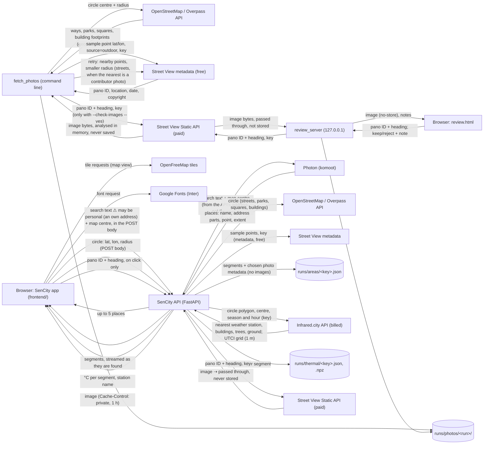

# Architecture

How the tool is built **now**:
- **Backend:** fetching street photo candidates for one circle.
- **Frontend:** the map start screen, address search and the two-click area selection.
- **API:** `POST /api/search` (Photon), `POST /api/area` (street segments and their photos, metadata only, then thermal comfort per segment from Infrared.city), `GET /api/photo/{pano_id}` (Street View images, passed through).
- **Thermal layer:** feels-like °C per street, scored 1–5 in the app with the standard limits.

There is no AI rating yet, so Senses and Overall stay inactive.

## Data flow

⚠ marks data that may be personal: what people type in search can be their own address. It is never logged or stored: the API forwards it to Photon and passes the answer back. Photon sees the API's address, not the user's. No other arrow carries personal data. Review notes are Elena's own judgement of the photos. The selected area stays in the browser (Pinia store) until analysis is built.

## Modules

| Path | What it does |
|---|---|
| `backend/tool/fetch_photos.py` | CLI: OSM → segments → metadata → selection → outputs; optional image check |
| `backend/tool/osm.py` | Overpass query, tag filters, sidewalk test, street and area segments |
| `backend/tool/segments.py` | Pure: chains between intersections, clip to circle, cut into ~50 m pieces, merge leftovers under 10 m |
| `backend/tool/candidates.py` | Sample points, metadata lookups with the contributor-photo retry, one candidate per (pano, heading) |
| `backend/tool/selection.py` | Pure: the photo choice rule (brief §4, steps 1–3 and 6), official only on streets, contributor fallback in areas, indoor photos rejected |
| `backend/tool/image_check.py` | 70% sharp/unblocked check per tile, in memory |
| `backend/tool/photos/provider.py` | `PhotoProvider` interface and `get_provider(cfg)` |
| `backend/tool/photos/streetview.py` | `StreetViewProvider` (metadata, image, cost) |
| `backend/tool/review.py`, `review_template.html` | Writes review.html with the run's data embedded (no key, no images) |
| `backend/tool/review_server.py` | FastAPI: `/` page, `/image` proxy, `GET/POST /notes` |
| `backend/tool/infrared.py` | Infrared.city run for one circle and window: job count check, nearest station, buildings, trees, ground, UTCI grid (billed) |
| `backend/tool/thermal.py` | Pure: grid cell centres, the percentile of the cells along each segment |
| `backend/tool/geo.py`, `config.py` | Local metric projection, circle, bearings; config and `.env` loading |
| `backend/app/main.py` | SenCity API (FastAPI): `POST /api/search`, CORS for the app's origin, a per-IP rate limit; no request bodies logged |
| `backend/app/search.py` | Photon request and result mapping (name, detail line, point, extent) |
| `backend/app/area.py` | Segments and chosen photos for one circle (the `tool/` pipeline, run in parallel), progress events, the area cache, the list of photos `/photo` may fetch; the thermal step and its cache |
| `backend/app/__main__.py` | `python -m app`: runs the API with access logs off |
| `backend/tests/` | Unit tests for segment splitting, selection and search (no API calls) |

**Frontend** (`frontend/`, Vue 3 + Vite, plain JavaScript):

| Path | What it does |
|---|---|
| `src/main.js`, `src/App.vue`, `src/router.js` | App entry; the only route is `/area` (`/` and any other path redirect there) |
| `src/views/MapView.vue` | Map view: places every floating panel from the viewport; phone layout below 768 px |
| `src/components/MapCanvas.vue` | MapLibre map, theme style swap, the two-click selection (pointer, touch, keyboard), crosshair, edge handle, radius chip, pan to keep the circle visible |
| `src/map/layers.js` | Our map layers: teal tint, lit circle, dimmed outside (world minus circle), dashed circle and radius line; colours read from `style.css` |
| `src/lib/geo.js` | Radius maths: haversine, limits (snap to 50 m, cap at 500 m, round to 10 m), 64-point circle, mask, photo estimate, coordinate label |
| `src/stores/area.js` | Pinia: selection step (`centre` → `radius` → `set` → `analysed`), centre, radius, the analysed area `{lat, lon, radius}`; loading the area (progress, cancel, errors), its segments, the selected segment; thermal comfort (state, window, station) and the layer on the map |
| `src/stores/theme.js` | Pinia: Appearance System / Light / Dark, follows `prefers-color-scheme` live, override in `localStorage` |
| `src/components/TopSearch.vue` | Logo + search: suggestions while typing (combobox, keyboard and pointer), messages for no results and errors; picking moves the map |
| `src/lib/api.js` | Calls to the SenCity API: `searchPlaces`, `loadArea` (reads the streamed events), `photoUrl`; error type, place-type labels |
| `src/components/ViewTabs.vue`, `TopActions.vue` | Area / Routes / Profile (bottom tab bar on a phone); About, Print, light/dark (one click), Ask, account |
| `src/components/AccountMenu.vue`, `AppearanceSwitch.vue` | Account menu (board P5) with the System / Light / Dark switch |
| `src/components/LayerPanel.vue`, `SeasonBar.vue`, `MapControls.vue`, `MapAttribution.vue` | Left panel (Thermal turns on with its feels-like legend once thermal comfort is ready; Senses and Overall wait for rating) and season bar (fixed at summer 15:00 for now), zoom and re-centre, credits |
| `src/components/StepHint.vue`, `AreaCard.vue` | Step hints (Flow 1, 1b, 1c) and the "This area" card (Flow 4 once loaded: Change area, the street stretches of the layer as one stacked bar with counts and %, places by type, Print area report as "Coming soon"; or why thermal is missing, with Try again; a bottom sheet on a phone) |
| `src/components/LoadingCard.vue` | "Loading this area" (Flow 2): street photos with progress; thermal and rating greyed; Cancel |
| `src/components/PlaceCard.vue` | The selected street (2f, 2g; phone P2): photo with arrows, enlarge badge, credit, thumbnails, date and direction; "Not rated yet"; on the Thermal layer the photo and name, then thermal comfort (2e): feels-like °C, state and why, the 1–5 bar, a cooler (or warmer) street nearby; no-photo state with "Go to the nearest street with photos" |
| `src/components/PhotoViewer.vue` | Enlarged photo (2f+; phone P2+ as a full page): arrows, swipe, thumbnails, keyboard, focus trap |
| `src/map/segments.js` | Segment layers (halo, core, dim, selected edge, invisible hit line) with hover and selection as feature-states; the Thermal layer lights every street with a value in its state colour |
| `src/lib/thermal.js` | Feels-like °C to the two-sided 1–5 score and state (brief §4), the reason line, legend lines, walking minutes, adding thermal to the segments |
| `src/lib/place.js` | Words for the cards: place type, size, "Looking north-east, July 2024", distance from the middle, credit, nearest street with photos |
| `src/components/AppLogo.vue`, `AppIcon.vue` | Logo (paths from `src/assets/logo/sencity.svg`, drawn in `var(--logo)`) and line icons |
| `src/styles/style.css` | Every colour, font and size as a CSS variable, dark and light |
| `src/config.js` | Radius limits, start view, map style URLs, photo estimate, default thermal window |
| `src/lib/geo.test.js`, `thermal.test.js` | Vitest: radius maths; thermal score, states and labels |
| `e2e/` | Playwright: step-by-step screenshots, fit-every-screen check, keyboard walk-through |

## Data formats

**Street segment, photo script** (`segments.geojson`, one feature each, WGS84):
`segment_id` str · `kind` "street" | "area" · `name` str · `highway` str (OSM type, or park/square) · `osm_ids` [str] · `length_m` float (streets) or `area_m2` float (areas) · `n_candidates` int · `pano_ids` [str] · `contributor_photos` int · `photos` [{`pano_id`, `heading`, `date`, `lat`, `lon`, `photo_type`}].

**Photo candidate** (`photos.csv`, one row per pano × heading × segment):
`segment_id`, `pano_id`, `lat`, `lon`, `date` (YYYY-MM), `heading` (°), `status` (kept/rejected), `reason`, `rank`, `dist_to_segment_m`, `dist_to_midpoint_m`, `photo_type` (official/contributor), `sharp_share` (0–1, only after the image check).

**Review note** (`review_notes.csv`): `segment_id`, `pano_id`, `heading`, `pipeline_status`, `pipeline_reason`, `verdict` (keep/reject/empty), `note`, `updated_at`.

**Run cache**: `osm.json` (raw Overpass answer), `buildings.json` (building footprints for the indoor test) and `metadata.json` (pano ID, location, date and copyright per segment, plus the total number of metadata calls and the retry counts). These let a re-run in the same folder make no new calls.

**Search** (`POST /api/search`): request `{ q: string (3–100 characters), lat: number | null, lon: number | null }` (the map centre ranks nearby places first). Response `{ results: [{ name: string, detail: string, lat: number, lon: number, kind: string, bbox?: [[west, south], [east, north]] }] }`, up to 5. Errors: 422 (too long), 429 (rate limit), 502 (Photon unavailable).

**Area** (`POST /api/area`, request `{ lat: number, lon: number, radius: number (50–500), season?: "spring" | "summer" | "autumn" | "winter", time?: "HH:00" }`, default summer 15:00): newline-separated JSON events. `{type: "segments", features, total}` gives all segments with `photos: null` (still looking). Then one `{type: "segment", feature, done, total}` per segment with its photos. Then `{type: "done", area: FeatureCollection, cached?: true}`, or `{type: "error", message}` (the stream ends). A cached area starts with "done". After "done": `{type: "stage", stage: "thermal"}`, then `{type: "thermal", season, time, station: {name, distance_km}, values: {segment id: °C | null}}` or `{type: "thermal_error", message}`.

**Street segment, app** (a feature of that FeatureCollection; `id` is also the feature id): geometry LineString (street) or Polygon (park, square, pedestrian area), WGS84. Properties: `id` str · `name` str (OSM name, or the way type if unnamed) · `named` bool · `place_type` "street" | "pedestrian" | "park" | "square" · `way_type` str (OSM highway or area tag) · `length_m` float (streets) or `area_m2` float (areas) · `photos` null | [{ `pano_id` str, `lat`, `lon` float, `heading` float (°), `date` "YYYY-MM", `contributor` bool }] (0–3, best first).

**Area cache** (`runs/areas/<key>.json`, not committed): `{ lat, lon, radius, created, area: FeatureCollection }`. The key is a hash of the circle and the pipeline settings. Neutral data only: no images, nothing about the person.

**Thermal cache** (`runs/thermal/<key>.json` and `.npz`, not committed): the values per segment and the station, and the UTCI grid (`grid` float32, row 0 south, NaN = no value; `bounds` min lon, min lat, max lon, max lat). The key is a hash of the area key, season, time and thermal settings. Neutral data only.

**Thermal on a segment, app** (added in the browser, `lib/thermal.js`): `utci` float (°C) · `thermal_score` 1–5 · `thermal_state` "easy" | "mixed" | "hard".

**Selected area** (frontend, `stores/area.js`, in the browser only): `{ lat: number, lon: number, radius: number }` (metres, 50–500, a multiple of 10).

Not built yet: the profile, the photo rating and the rating cache entry.

## External services

| Service | Used for | Region | What it keeps |
|---|---|---|---|
| Overpass API (overpass-api.de) | OSM ways, parks, squares and buildings for one circle (the `fetch_photos` script and `/api/area`) | Germany | Request logs (circle query only, from our API's address) |
| Google Street View metadata | Pano ID, location, date per sample point (free) | Google | API usage per key |
| Google Street View Static API | Images for the app's place card and enlarged photo (`/api/photo`, on click only), the image check and the review page (paid, ~$7/1000, 10,000 free/month) | Google | API usage per key; the images are never stored by us |
| OpenFreeMap | Base map tiles in the app (Positron light, Dark) and review.html | EU | Tile request logs |
| Google Fonts | Inter font for the app | Google | Request logs (IP address) |
| Infrared.city API (api.infrared.city) | Thermal comfort (UTCI) for one circle and window: weather station lookup, public buildings, trees and ground materials, the simulation (billed, 10 tokens per 512 m tile) | Infrared.city | API usage per key; it receives the circle and the window from our API, nothing about the person |
| Photon (photon.komoot.io) | Address and place search, OpenStreetMap data | Germany (komoot) | Request logs per its fair-use terms; it receives the search text and the map centre from our API, never the user's IP |

## Configuration

- **Environment** (`.env` at the repo root, names only): `GOOGLE_MAPS_API_KEY`, `INFRARED_API_KEY`. Template: `.env.example`.
- **`config/tool.yaml`**: `thermal` section (season days, default window, station radius, job limit, buffer, percentile, cache folder, runs per IP per hour); `api` section (allowed browser origins, Photon URL, search limits, rate limit per IP); radius limits, optional allowed-area polygon, OSM tag lists, segment length, photo source, Street View crop and prices, sampling, selection thresholds, image check thresholds, run folder.
- **`backend/requirements.txt`**: Python 3.11+ dependencies.
- **`frontend/src/config.js`**: radius limits (50–500 m, default 200, rounding 10 m), start view, map style URLs, photo estimate, default season and time, thermal limits (°C), API base (`VITE_API_BASE`, empty = same origin), search timing.
- **`frontend/vite.config.js`**: dev server on port 5173, `/api` forwarded to the API on port 8000. `frontend/dev-api.js` starts the API with `npm run dev`.
- **`frontend/src/styles/style.css`**: design tokens (brief §9) and map overlay colours and opacities, for dark and light.
- **`frontend/package.json`**: Vue, Pinia, Vue Router, MapLibre GL JS; Vite, Vitest, Playwright for development.
