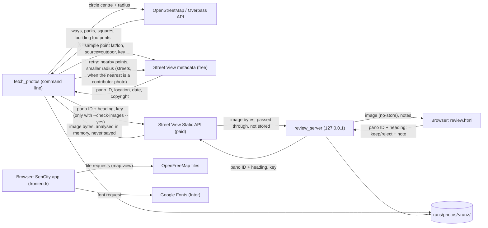

# Architecture

How the tool is built **now**:
- **Backend:** fetching street photo candidates for one circle.
- **Frontend:** the map start screen and the two-click area selection, with no backend calls yet.

There is no AI rating and no Infrared.city yet.

## Data flow

No personal data crosses any of these arrows. Review notes are Elena's own judgement of the photos. The app does not call the backend yet: the selected area stays in the browser (Pinia store).

## Modules

| Path | What it does |
|---|---|
| `backend/tool/fetch_photos.py` | CLI: OSM → segments → metadata → selection → outputs; optional image check |
| `backend/tool/osm.py` | Overpass query, tag filters, sidewalk test, street and area segments |
| `backend/tool/segments.py` | Pure: chains between intersections, clip to circle, cut into ~50 m pieces, merge leftovers under 10 m |
| `backend/tool/candidates.py` | Sample points, metadata lookups with the contributor-photo retry, one candidate per (pano, heading) |
| `backend/tool/selection.py` | Pure: the photo choice rule (brief §4, steps 1–3 and 6), official only on streets, contributor fallback in areas, indoor photos rejected |
| `backend/tool/image_check.py` | 70% sharp/unblocked check per tile, in memory |
| `backend/tool/photos/provider.py` | `PhotoProvider` interface and `get_provider(cfg)` |
| `backend/tool/photos/streetview.py` | `StreetViewProvider` (metadata, image, cost) |
| `backend/tool/review.py`, `review_template.html` | Writes review.html with the run's data embedded (no key, no images) |
| `backend/tool/review_server.py` | FastAPI: `/` page, `/image` proxy, `GET/POST /notes` |
| `backend/tool/geo.py`, `config.py` | Local metric projection, circle, bearings; config and `.env` loading |
| `backend/tests/` | Unit tests for segment splitting and selection (no API calls) |

**Frontend** (`frontend/`, Vue 3 + Vite, plain JavaScript):

| Path | What it does |
|---|---|
| `src/main.js`, `src/App.vue`, `src/router.js` | App entry; the only route is `/map` (`/` redirects there) |
| `src/views/MapView.vue` | Map view: places every floating panel from the viewport; phone layout below 768 px |
| `src/components/MapCanvas.vue` | MapLibre map, theme style swap, the two-click selection (pointer, touch, keyboard), crosshair, edge handle, radius chip, pan to keep the circle visible |
| `src/map/layers.js` | Our map layers: teal tint, lit circle, dimmed outside (world minus circle), dashed circle and radius line; colours read from `style.css` |
| `src/lib/geo.js` | Radius maths: haversine, limits (snap to 50 m, cap at 500 m, round to 10 m), 64-point circle, mask, photo estimate, coordinate label |
| `src/stores/area.js` | Pinia: selection step (`centre` → `radius` → `set` → `analysed`), centre, radius, the analysed area `{lat, lon, radius}` |
| `src/stores/theme.js` | Pinia: Appearance System / Light / Dark, follows `prefers-color-scheme` live, override in `localStorage` |
| `src/components/TopSearch.vue`, `ViewTabs.vue`, `TopActions.vue` | Top bar: logo + search (inactive), Map / Compare / Profile (bottom tab bar on a phone), About, Print, light/dark (one click), Ask, account |
| `src/components/AccountMenu.vue`, `AppearanceSwitch.vue` | Account menu (board P5) with the System / Light / Dark switch |
| `src/components/LayerPanel.vue`, `SeasonBar.vue`, `MapControls.vue`, `MapAttribution.vue` | Left panel and season bar (inactive until an area is loaded), zoom and re-centre, credits |
| `src/components/StepHint.vue`, `AreaCard.vue` | Step hints (Flow 1, 1b, 1c) and the "This area" card (a bottom sheet on a phone) |
| `src/components/AppLogo.vue`, `AppIcon.vue` | Logo (paths from `src/assets/logo/sencity.svg`, drawn in `var(--logo)`) and line icons |
| `src/styles/style.css` | Every colour, font and size as a CSS variable, dark and light |
| `src/config.js` | Radius limits, start view, map style URLs, photo estimate, default heat window |
| `src/lib/geo.test.js` | Vitest: radius maths |
| `e2e/` | Playwright: step-by-step screenshots, fit-every-screen check, keyboard walk-through |

## Data formats

**Street segment** (`segments.geojson`, one feature each, WGS84):
`segment_id` str · `kind` "street" | "area" · `name` str · `highway` str (OSM type, or park/square) · `osm_ids` [str] · `length_m` float (streets) or `area_m2` float (areas) · `n_candidates` int · `pano_ids` [str] · `contributor_photos` int · `photos` [{`pano_id`, `heading`, `date`, `lat`, `lon`, `photo_type`}].

**Photo candidate** (`photos.csv`, one row per pano × heading × segment):
`segment_id`, `pano_id`, `lat`, `lon`, `date` (YYYY-MM), `heading` (°), `status` (kept/rejected), `reason`, `rank`, `dist_to_segment_m`, `dist_to_midpoint_m`, `photo_type` (official/contributor), `sharp_share` (0–1, only after the image check).

**Review note** (`review_notes.csv`): `segment_id`, `pano_id`, `heading`, `pipeline_status`, `pipeline_reason`, `verdict` (keep/reject/empty), `note`, `updated_at`.

**Run cache**: `osm.json` (raw Overpass answer), `buildings.json` (building footprints for the indoor test) and `metadata.json` (pano ID, location, date and copyright per segment, plus the total number of metadata calls and the retry counts). These let a re-run in the same folder make no new calls.

**Selected area** (frontend, `stores/area.js`, in the browser only): `{ lat: number, lon: number, radius: number }` (metres, 50–500, a multiple of 10).

Not built yet: the profile, the photo rating and the rating cache entry.

## External services

| Service | Used for | Region | What it keeps |
|---|---|---|---|
| Overpass API (overpass-api.de) | OSM ways, parks and squares for one circle | Germany | Request logs (circle query only) |
| Google Street View metadata | Pano ID, location, date per sample point (free) | Google | API usage per key |
| Google Street View Static API | Images for the image check and review page (paid, ~$7/1000, 10,000 free/month) | Google | API usage per key |
| OpenFreeMap | Base map tiles in the app (Positron light, Dark) and review.html | EU | Tile request logs |
| Google Fonts | Inter font for the app | Google | Request logs (IP address) |

## Configuration

- **Environment** (`.env` at the repo root, names only): `GOOGLE_MAPS_API_KEY`. Template: `.env.example`.
- **`config/tool.yaml`**: radius limits, optional allowed-area polygon, OSM tag lists, segment length, photo source, Street View crop and prices, sampling, selection thresholds, image check thresholds, run folder.
- **`backend/requirements.txt`**: Python 3.11+ dependencies.
- **`frontend/src/config.js`**: radius limits (50–500 m, default 200, rounding 10 m), start view, map style URLs, photo estimate, default season and time.
- **`frontend/src/styles/style.css`**: design tokens (brief §9) and map overlay colours and opacities, for dark and light.
- **`frontend/package.json`**: Vue, Pinia, Vue Router, MapLibre GL JS; Vite, Vitest, Playwright for development.
