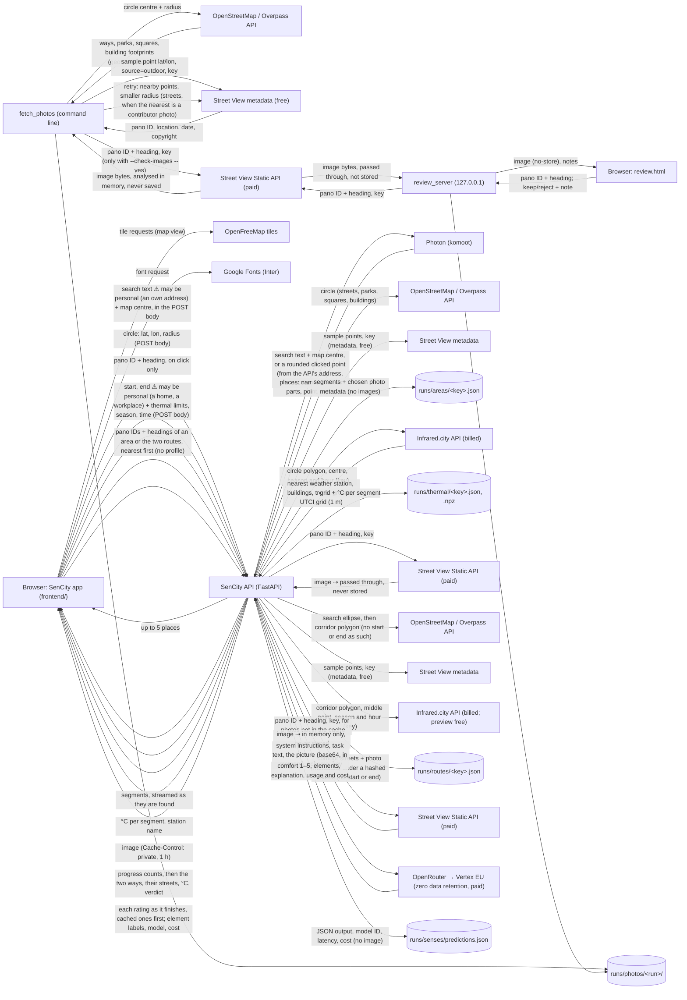

# Architecture

How the tool is built **now**:
- **Backend:** fetching street photo candidates for one circle.
- **Frontend:** the map start screen, address search and the two-click area selection.
- **API:** `POST /api/search` and `POST /api/reverse` (Photon), `POST /api/area` (street segments and their photos, metadata only, then thermal comfort per segment from Infrared.city), `POST /api/routes` (two walking routes between two points), `GET /api/photo/{pano_id}` (Street View images, passed through).
- **Thermal layer:** feels-like °C per street, rated easy, mixed or hard in the app with the standard limits.
- **Routes:** Start and End, the shortest and the easiest way on Thermal, compared stretch by stretch.
- **Senses (general, no profile):** every photo of an area or of the two routes is rated in the background (`POST /api/senses/rate`), from the settings in `model/app_v0/`. Places appear on the map as ratings arrive, with recommendations beside them.

There are no profiles yet, and Overall stays inactive.

## Data flow

⚠ marks data that may be personal: what people type in search can be their own address. It is never logged or stored: the API forwards it to Photon and passes the answer back. Photon sees the API's address, not the user's. The start and end of a route can be a home and a workplace: they are never logged or stored. The services see only polygons around the way, but the search ellipse's foci are the two points and the corridor runs from one to the other, so these do show roughly where someone walks, as does the route cache. No other arrow carries personal data. Review notes are Elena's own judgement of the photos. The selected area stays in the browser (Pinia store) until analysis is built.

## Modules

| Path | What it does |
|---|---|
| `backend/tool/fetch_photos.py` | CLI: OSM → segments → metadata → selection → outputs; optional image check |
| `backend/tool/osm.py` | Overpass query, tag filters, sidewalk test, street and area segments |
| `backend/tool/osm_local.py` | Local copy of OpenStreetMap for Vienna, in tiles (`python -m tool.osm_local`); answers for a circle or a polygon in Overpass's shape, or leaves it to Overpass |
| `backend/tool/segments.py` | Pure: chains between intersections, clip to circle, cut into ~50 m pieces, merge leftovers under 10 m |
| `backend/tool/candidates.py` | Sample points, metadata lookups with the contributor-photo retry, one candidate per (pano, heading) |
| `backend/tool/selection.py` | Pure: the photo choice rule (brief §4, steps 1–3 and 6), official only on streets, contributor fallback in areas, indoor photos rejected |
| `backend/tool/image_check.py` | 70% sharp/unblocked check per tile, in memory |
| `backend/tool/photos/provider.py` | `PhotoProvider` interface and `get_provider(cfg)` |
| `backend/tool/photos/streetview.py` | `StreetViewProvider` (metadata, image, cost) |
| `backend/tool/review.py`, `review_template.html` | Writes review.html with the run's data embedded (no key, no images) |
| `backend/tool/review_server.py` | FastAPI: `/` page, `/image` proxy, `GET/POST /notes` |
| `backend/tool/infrared.py` | Infrared.city run for one circle and window: job count check, nearest station, buildings, trees, ground, UTCI grid (billed) |
| `backend/tool/thermal.py` | Pure: `thermal_state` (the app's band rule, for the routes), grid cell centres, the percentile of the cells along each segment |
| `backend/tool/geo.py`, `config.py` | Local metric projection, circle, bearings; config and `.env` loading |
| `backend/app/main.py` | SenCity API (FastAPI): `POST /api/search`, `/api/reverse`, `/api/area`, `/api/routes`, `GET /api/photo`, CORS for the app's origin, a per-IP rate limit; no request bodies logged |
| `backend/app/search.py` | Photon request and result mapping (name, detail line, point, extent); the name of a clicked point (spaced calls, in-memory cache) |
| `backend/app/steps.py` | The finished steps of a load that did not complete (Overpass answer, photos per segment), read back by the next try for the same key |
| `backend/app/area.py` | Segments and chosen photos for one circle (the `tool/` pipeline, run in parallel), progress events, the area cache, the list of photos `/photo` may fetch; the thermal step and its cache |
| `backend/tool/routing.py` | Pure: the graph on the street segments (gaps closed with short connectors), snapping a point to a street, Dijkstra, different ways, choosing B |
| `backend/app/routes.py` | Two routes: search ellipse, corridor that fits the tile limit, its photos, the route cache, A and B, the verdict sentence |
| `backend/app/senses.py` | Senses mode: reads and checks `model/app_v0/` on every request, splits a list of photos into cached and new (the cap), rates the new ones 4 at a time: the picture from Street View in memory, the task text, the OpenRouter request, the reply validated (one retry); the cache |
| `model/app_v0/` | Exported from the thesis repo: system instructions, task text, the two schemas, element labels, model settings, MANIFEST. The only source of these; replaced as a folder |
| `backend/app/__main__.py` | `python -m app`: runs the API with access logs off |
| `backend/tests/` | Unit tests for segment splitting, selection and search (no API calls) |

**Frontend** (`frontend/`, Vue 3 + Vite, plain JavaScript):

| Path | What it does |
|---|---|
| `src/main.js`, `src/App.vue`, `src/router.js` | App entry; `/area` and `/routes` are one view around one map (`/` and any other path redirect to `/area`) |
| `src/views/MapView.vue` | Map view, for Area and Routes: places every floating panel from the viewport; phone layout below 768 px |
| `src/components/MapCanvas.vue` | MapLibre map, theme style swap, the two-click selection (pointer, touch, keyboard), crosshair, edge handle, radius chip, pan to keep the circle visible; in Routes: clicks set Start and End, pins, hover and click on a stretch, fit the way in the free space |
| `src/map/routes.js` | Route layers: each street in its state colour, A continuous, B dashed over runs of one state, glow, selected edge, the rest dimmed on hover |
| `src/stores/routes.js` | Pinia: Start, End, the preview before Analyse, loading the ways (progress, cancel, errors), the routes and their stretches, shown or hidden, selected stretch, linked hover, season and time |
| `src/lib/routes.js` | Pure: a route's parts to stretches (one per street), runs of one state, a stretch as one place for the card, distances |
| `src/components/RoutePanel.vue`, `RouteLayerButtons.vue` | Routes left panel (desktop, tablet): the walk inputs (`RouteInputs`), Layer, season and time, legend (last). On a phone the route card carries the same inputs and Layer, as the area sheet does |
| `src/components/RouteCard.vue`, `RouteBar.vue` | "Which way feels better?" (no card before Analyse on desktop and tablet; the hint says what to do): the progress, the comparison; on a phone also the inputs with Analyse; one state bar per route, each street a button (a bottom sheet on a phone) |
| `src/components/StretchCard.vue` | A selected stretch: the place card with the route bar, coverage, previous / next, arrow keys |
| `src/components/PlaceSearch.vue` | One search field with suggestions, used by the top bar, Centre, Start and End; reports Enter on a value already chosen |
| `src/map/base.js` | Dark mode only: recolours the Positron base map from `--map-base-*` in `style.css`, after every style load |
| `src/map/layers.js` | Our map layers: teal tint, lit circle, dimmed outside (world minus circle), dashed circle and radius line; colours read from `style.css` |
| `src/lib/geo.js` | Radius maths: haversine, limits (snap to 50 m, cap at 500 m, round to 10 m), 64-point circle, mask, photo estimate, coordinate label |
| `src/stores/area.js` | Pinia: selection step (`centre` → `radius` → `set` → `analysed`), centre, radius, the analysed area `{lat, lon, radius}`; loading the area (progress, cancel, errors), its segments, the Places filter (`placeFilter`, `visibleSegments`); the markers (`suggestions` on the Thermal layer, `chatMarkers` hook with `showChatResults` / `clearChatResults`, `markersCollapsed` (hidden after selecting an unmarked place), `seenIds`); the selected segment (and `cameFrom`, the street a nearby link was followed from; `goNearby`, `goBack`); thermal comfort (state, window, station) and the layer on the map |
| `src/stores/theme.js` | Pinia: Appearance System / Light / Dark, follows `prefers-color-scheme` live, override in `localStorage` |
| `src/components/TopSearch.vue` | Logo + search (`PlaceSearch`); picking moves the map |
| `src/lib/api.js` | Calls to the SenCity API: `searchPlaces`, `pointName`, `loadArea` and `loadRoutes` (read the streamed events), `photoUrl`; error type, place-type labels |
| `src/components/ViewTabs.vue`, `TopActions.vue` | Area / Routes / Profile (bottom tab bar on a phone); About, Print, light/dark (one click), Ask, account |
| `src/components/AccountMenu.vue`, `AppearanceSwitch.vue` | Account menu (board P5) with the System / Light / Dark switch |
| `src/components/LayerPanel.vue`, `MapControls.vue`, `MapAttribution.vue` | Left panel, controls first and the legend last: the area inputs (`AreaInputs`), Layer, Season and time (not for Senses), Places buttons (All / Streets / Parks / Squares filter the map and the suggestions once the area is loaded), then the legend of the chosen layer (`LayerLegend`); zoom and re-centre; credits |
| `src/components/PhoneSheet.vue` | The one bottom sheet on a phone: tabs Settings (`LayerPanel` or `RoutePanel`) and Results (the cards), minimised or open at one fixed height, dragging, the automatic switching, and the legend strip and credits riding above it |
| `src/components/ChoiceButtons.vue`, `LayerLegend.vue` | The one kind of choice control: separate bordered buttons as a radiogroup, thick (Layer) or thin (Places, Radius, Season); and the legend of the chosen layer, with its title |
| `src/components/LayerButtons.vue`, `SeasonTime.vue` | Area layer buttons (left panel, or the area card when the left panel gives way), only Thermal active until the ratings are built, and Season and time: four season buttons and a 9–21 h slider, shown for Thermal and Overall (and before analysis), used by the left panel, the Routes panel and, on a phone or below 1200 px, the area and route cards; active before analysis (Analyse uses the choice) and once thermal is ready, where a new season or time asks for thermal again |
| `src/components/InputSection.vue`, `AreaInputs.vue`, `RouteInputs.vue`, `AnalyseAction.vue` | The area and walk inputs at the top of the left panel (or the sheet): closed, one row with an icon, the values ("Graben · 200 m", "Clicked point → …"), a chevron and Change (clears everything); open, Centre and Radius (100 / 200 / 500 m, plus the mouse's value) or Start and End (address search) with a swap button; under them Analyse and its estimate line, disabled until everything is set (Enter in Centre or End starts it). A city only pans the map; a focused field takes the next map click |
| `src/components/StepHint.vue`, `AreaCard.vue` | Step hints (Flow 1, 1b, 1c; Routes 1), with "type an address" that opens the inputs and focuses the first empty field, and the "This area" card (Flow 4 once loaded: the street stretches of the layer as one stacked bar with counts and %, "Likely easiest for you" (numbered as the map pins, seen ticks, or "Nothing easy here"), places by type, Print area report as "Coming soon"; or why thermal is missing, with Try again; a bottom sheet on a phone) |
| `src/components/MarkerPin.vue` | The numbered marker badge (map pin and list row) |
| `src/components/ThermalLegend.vue` | The thermal legend, last in the Area and Routes panels after a divider, shown once the area's thermal comfort or the routes are loaded: title "Thermal comfort °C" with an info icon (tooltip on hover, focus or tap: what the feels-like temperature is, the easy range, the source), Easy with its range, Mixed and Hard only for the side the values reach |
| `src/components/LoadingCard.vue` | "Loading this area" (Flow 2, 3): streets, then street photos with progress; thermal, or on Senses the rating with its progress and running cost; Cancel (while rating, it only stops the rating) |
| `src/components/PlaceCard.vue` | The selected street (2f, 2g; phone P2): photo (only when `lib/photos.js` shows photos; else "Photo not shown") with arrows, enlarge badge, credit, thumbnails, date and direction; "Not rated yet"; on the Thermal layer the photo and name, then thermal comfort (2e): feels-like °C, state and why, a temperature bar on the legend's side rule, a cooler (or warmer) street nearby as a link that selects it and zooms there, and "Back to <street>" on the card it opens; no-photo state with "Go to the nearest street with photos" |
| `src/components/PhotoViewer.vue` | Enlarged photo (2f+; phone P2+ as a full page): arrows, swipe, thumbnails, keyboard, focus trap |
| `src/map/segments.js` | Segment layers (halo, core, dim, selected edge, invisible hit line) with hover and selection as feature-states; the Thermal layer lights every street with a value in its state colour |
| `src/map/markers.js` | Marked places (suggestions, later chat results): each stretch or outline thicker in its level colour with a light outline, above the street colours and below the hit layers |
| `src/lib/thermal.js` | `thermalLimits()` (the standard limits from config, for everyone; the only reader); feels-like °C to the state (easy, mixed, hard; no score); the card's temperature bar (`thermalBar`, `barPosition`, `barLabel`); `comfortKey` / `compareComfort` (degrees outside the easy range, then distance from its middle, shared by the nearby street and the suggestions); the card line ("Hard: above 32 °C"), legend rows for the side the values reach and the note under it; walking minutes; adding thermal to the segments |
| `src/lib/suggest.js` | "Likely easiest for you": `pickSuggestions` (greedy, at least `config.suggest.minApartM` apart, a new type first within `margin`, ties to the nearer centre; any layer passes its own keep and value) and `thermalSuggestions` (easy places in the Places filter, closest to the middle of the easy range first, via `comfortKey`) |
| `src/lib/nearby.js` | "Easier street nearby": `easierNearby` (within `config.nearby.maxM`, at least one level better, the best rank first, then the shortest walk; any layer passes its own level and rank) and `easierThermalNearby` (Thermal, ranked by `comfortKey`) |
| `src/lib/place.js` | The place filter (All, Streets, Parks, Squares) and which one a segment belongs to; words for the cards: place type, size, "Looking north-east, July 2024", distance from the middle, credit, nearest street with photos |
| `src/lib/photos.js` | Which street photos are shown: `none` (default), `streetview` or `mapillary` (not built), the image URL and credit |
| `src/stores/senses.js` | Pinia: starts the rating when an area or the two routes are ready; the ratings by photo, the run (progress, cost, the question above the cap, errors, Retry), the state of each street for the map |
| `src/components/SensesPanel.vue` | In the area and route cards: progress and running cost, the question above the cap, the label and status line, and once the rating has ended most comfortable nearby |
| `src/lib/senses.js` | Pure: one place from its photos (median, shared elements), the recommendations, a route's hard share and verdict on Senses, a 1–5 rating to its state (easy, mixed, hard), "4 · fairly comfortable" (the survey's words for 1 and 5), an element's label in the app's language, the status line |
| `src/components/SensesFoot.vue` | The end of a Senses card, area or routes: "General prediction: not yet personal" and the status line |
| `src/components/SensesPrediction.vue`, `SenseIcon.vue` | A place's rating on the place and stretch card (board 2c), from the ratings already here: waiting, "Could not rate" with Retry, the rating bar, might bother and feel good, the model's explanation; one sense icon |
| `src/components/AppLogo.vue`, `AppIcon.vue` | Logo (paths from `src/assets/logo/sencity.svg`, drawn in `var(--logo)`) and line icons |
| `src/styles/style.css` | Every colour, font and size as a CSS variable, dark and light |
| `src/config.js` | Radius limits, start view, map style URLs, photo estimate, default thermal window |
| `src/lib/geo.test.js`, `thermal.test.js`, `routes.test.js` | Vitest: radius maths; thermal score, states and labels; stretches |
| `e2e/` | Playwright: step-by-step screenshots, fit-every-screen check, keyboard walk-through, Routes |

## Data formats

**Street segment, photo script** (`segments.geojson`, one feature each, WGS84):
`segment_id` str · `kind` "street" | "area" · `name` str · `highway` str (OSM type, or park/square) · `osm_ids` [str] · `length_m` float (streets) or `area_m2` float (areas) · `n_candidates` int · `pano_ids` [str] · `contributor_photos` int · `photos` [{`pano_id`, `heading`, `date`, `lat`, `lon`, `photo_type`}].

**Photo candidate** (`photos.csv`, one row per pano × heading × segment):
`segment_id`, `pano_id`, `lat`, `lon`, `date` (YYYY-MM), `heading` (°), `status` (kept/rejected), `reason`, `rank`, `dist_to_segment_m`, `dist_to_midpoint_m`, `photo_type` (official/contributor), `sharp_share` (0–1, only after the image check).

**Review note** (`review_notes.csv`): `segment_id`, `pano_id`, `heading`, `pipeline_status`, `pipeline_reason`, `verdict` (keep/reject/empty), `note`, `updated_at`.

**Run cache**: `osm.json` (raw Overpass answer), `buildings.json` (building footprints for the indoor test) and `metadata.json` (pano ID, location, date and copyright per segment, plus the total number of metadata calls and the retry counts). These let a re-run in the same folder make no new calls.

**Search** (`POST /api/search`): request `{ q: string (3–100 characters), lat: number | null, lon: number | null }` (the map centre ranks nearby places first). Response `{ results: [{ name: string, detail: string, lat: number, lon: number, kind: string, bbox?: [[west, south], [east, north]] }] }`, up to 5. Errors: 422 (too long), 429 (rate limit), 502 (Photon unavailable).

**Reverse** (`POST /api/reverse`): request `{ lat: number, lon: number }`. Response `{ name: string | null }`. Errors: 429 (rate limit), 502 (Photon unavailable).

**Area** (`POST /api/area`, request `{ lat: number, lon: number, radius: number (50–500), season?: "spring" | "summer" | "autumn" | "winter", time?: "HH:00" }`, default summer 15:00): newline-separated JSON events. `{type: "segments", features, total}` gives all segments with `photos: null` (still looking). Then one `{type: "segment", feature, done, total}` per segment with its photos. Then `{type: "done", area: FeatureCollection, cached?: true}`, or `{type: "error", message}` (the stream ends). A cached area starts with "done". After "done": `{type: "stage", stage: "thermal"}`, then `{type: "thermal", season, time, station: {name, distance_km}, values: {segment id: °C | null}}` or `{type: "thermal_error", message}`.

**Street segment, app** (a feature of that FeatureCollection; `id` is also the feature id): geometry LineString (street) or Polygon (park, square, pedestrian area), WGS84. Properties: `id` str · `name` str (OSM name, or the way type if unnamed) · `named` bool · `place_type` "street" | "pedestrian" | "park" | "square" · `way_type` str (OSM highway or area tag) · `length_m` float (streets) or `area_m2` float (areas) · `photos` null | [{ `pano_id` str, `lat`, `lon` float, `heading` float (°), `date` "YYYY-MM", `contributor` bool }] (0–3, best first).

**Area cache** (`runs/areas/<key>.json`, not committed): `{ lat, lon, radius, created, area: FeatureCollection }`. The key is a hash of the circle and the pipeline settings. Neutral data only: no images, nothing about the person.

**Finished steps of an unfinished load** (`runs/areas/<key>.osm.json` and `<key>.photos.json`; for a route `runs/routes/<key>.ways.json`, `.buildings.json`, `.photos.json`; not committed; `backend/app/steps.py`): when the photo lookups fail or the app cancels, the Overpass answer and the photos chosen so far per segment id (pano ID, location, date, heading) are kept, so "Try again" makes only the missing calls and is not counted as a new area or route. Removed once the load completes. No images, and no start or end of a route.

**Thermal cache** (`runs/thermal/<key>.json` and `.npz`, not committed): the values per segment and the station, and the UTCI grid (`grid` float32, row 0 south, NaN = no value; `bounds` min lon, min lat, max lon, max lat). The key is a hash of the area key, season, time and thermal settings. Neutral data only.

**Thermal on a segment, app** (added in the browser, `lib/thermal.js`): `utci` float (°C) · `thermal_state` "easy" | "mixed" | "hard" (no score).

**Routes** (`POST /api/routes`): request `{ start: {lat, lon}, end: {lat, lon}, limits: {heat: [3 °C], cold: [4 °C]}, season?, time?, layer?: "senses" | "thermal" | "overall" }` (`senses`: no thermal stage; season, time and station are null, and the "routes" event has empty `routes` and a `candidates` list of ways, in the shape of a route, from which the app picks A and B once their streets are rated). Refused with 422 when the points are under 50 m or over 1.5 km apart, 429 for too many new routes. Newline-separated JSON events: `{type: "stage", stage: "streets" | "thermal" | "routes"}`, `{type: "segments", total}`, `{type: "segment", done, total}` (counts only: nothing is drawn yet), then `{type: "routes", season, time, station, routes, verdict, segments: FeatureCollection (the streets of both ways, as in Area), values: {segment id: °C | null}}`. Or `{type: "error", message}` or `{type: "thermal_error", message}`; the stream ends.

**A route**: `id` "A" | "B" · `kind` "shortest" | "easiest" | "second" · `length_m` · `minutes` · `hard_share`, `mixed_share`, `thermal_share`, `photo_share` (0–1, of the length) · `parts` [{ `segment_id` str | null (a connector), `length_m`, `coordinates` [[lon, lat]] }] in walking order.

**A stretch, app** (`lib/routes.js`): `key` "A-2" · `routeId` · `index` · `state` "easy" | "mixed" | "hard" | "none" · `segmentId` · `length_m` · `coordinates`. One street segment of the route; a connector joins the stretch before it.

**Route cache** (`runs/routes/<key>.json`, not committed): `{ created, lat, lon (the middle), zone (corridor polygon), area: FeatureCollection }`. The key is a hash of the two points, either way round, and the settings. No start or end, and nothing about the person. Thermal comfort for it is in `runs/thermal/`, as for an area.

**Local OpenStreetMap copy** (`data/osm/vienna/<column>_<row>.json`, not committed): `{ elements: [...] }`, the raw Overpass answer (`out geom`) for one tile: walkable ways, parks, squares, buildings. OpenStreetMap data only.

**Selected area** (frontend, `stores/area.js`, in the browser only): `{ lat: number, lon: number, radius: number }` (metres, 50–500, a multiple of 10).

**Senses rating** (`POST /api/senses/rate`): request `{ photos: [{ pano_id, heading }] }`, nearest first. Newline-separated JSON events: `{type: "start", model, cached, to_rate, remaining}`; one `{type: "photo", pano_id, heading, status: "ok" | "failed", cached, result | error, cost_usd?, streetview_usd?}` per photo; then `{type: "done", seconds, failed, remaining, estimate_usd, estimate_streetview_usd}`, or `{type: "error", message}` when going on is pointless. A result: `{ comfort: 1–5, anchors: [words of 1, words of 5], bothers: [element], feels_good: [element], reason, model, latency_ms, cost_usd | null, cached }`; an element as in `elements.json`: `{ code, en, it, sense | null, kind | null }`. Errors before the stream: 429 (rate limit), 503 (`model/app_v0/` unusable, or no key).

**A place, Senses, app** (`lib/senses.js`, in the browser only): `status` "pending" | "rated" | "failed" · `comfort` 1–5 (median of its photos) · `level` easy | mixed | hard · `bothers`, `feelsGood` (elements shared by the photos) · `rep` (the photo the card opens on) · `nPhotos`, `nRated`, `nFailed`, `nPending`.

**Senses cache** (`runs/senses/predictions.json`, not committed): `{ "<pano ID>|<heading>|<MANIFEST commit>": { output: the model's JSON, model: string, latency_ms: int, cost_usd: number | null } }`. No images, nothing about the person.

Not built yet: the profile.

## External services

| Service | Used for | Region | What it keeps |
|---|---|---|---|
| Overpass API (overpass-api.de) | OSM ways, parks, squares and buildings for one circle (the `fetch_photos` script and `/api/area`), or the streets and buildings around a route (`/api/routes`) | Germany | Request logs (the circle or polygon, from our API's address) |
| Google Street View metadata | Pano ID, location, date per sample point (free) | Google | API usage per key |
| Google Street View Static API | Images for the app's place card and enlarged photo (`/api/photo`, on click only), the image check and the review page (paid, ~$7/1000, 10,000 free/month) | Google | API usage per key; the images are never stored by us |
| OpenFreeMap | Base map tiles in the app (Positron, recoloured in dark mode) and review.html | EU | Tile request logs |
| Google Fonts | Inter font for the app | Google | Request logs (IP address) |
| Infrared.city API (api.infrared.city) | Thermal comfort (UTCI) for one circle and window: weather station lookup, public buildings, trees and ground materials, the simulation (billed, 10 tokens per 512 m tile) | Infrared.city | API usage per key; it receives the circle and the window from our API, nothing about the person |
| OpenRouter → Google Vertex AI (EU endpoint) | The general prediction for one street photo, with the model and pinned endpoint in `model/app_v0/model.json` (paid per call) | EU endpoint (`google-vertex/eu`) | Zero data retention requested on every call (`zdr: true`, `data_collection: deny`, no fallbacks); it receives the picture, the system instructions and the task text, nothing about the person |
| Photon (photon.komoot.io) | Address and place search, OpenStreetMap data | Germany (komoot) | Request logs per its fair-use terms; it receives the search text and the map centre, or a clicked point rounded to about 10 m, from our API, never the user's IP |

## Configuration

- **Environment** (`.env` at the repo root, names only): `GOOGLE_MAPS_API_KEY`, `INFRARED_API_KEY`, `OPENROUTER_API_KEY`. Template: `.env.example`.
- **`model/app_v0/`**: all model settings for the Senses predictions, as exported from the thesis repo.
- **`config/tool.yaml`**, `osm_local`: the city's box, tile size, pause and folder of the local OpenStreetMap copy (its own section, so the area and route cache keys do not change with it). Also: `routes` section (longest walk, tile limit, 25% rule, search ellipse, corridor width, gap closing, weights for finding B, cache folder, new routes per IP per hour); `thermal` section (season days, default window, station radius, job limit, buffer, percentile, cache folder, runs per IP per hour); `api` section (allowed browser origins, Photon URL, search limits, rate limit per IP); radius limits, optional allowed-area polygon, OSM tag lists, segment length, photo source, Street View crop and prices, sampling, selection thresholds, image check thresholds, run folder.
- **`backend/requirements.txt`**: Python 3.11+ dependencies.
- **`frontend/src/config.js`**: radius limits (50–500 m, default 200, rounding 10 m), start view, map style URLs, photo estimate, default season and time, thermal limits (°C), route limits (shown before asking; keep them equal to `routes` in `config/tool.yaml`), API base (`VITE_API_BASE`, empty = same origin), search timing.
- **`frontend/vite.config.js`**: dev server on port 5173, `/api` forwarded to the API on port 8000. `frontend/dev-api.js` starts the API with `npm run dev`.
- **`frontend/src/styles/style.css`**: design tokens (brief §9) and map overlay colours and opacities, for dark and light.
- **`frontend/package.json`**: Vue, Pinia, Vue Router, MapLibre GL JS; Vite, Vitest, Playwright for development.
